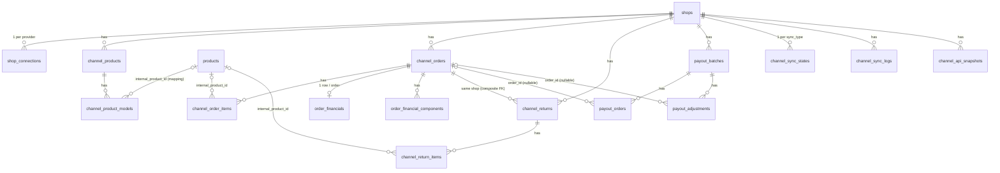

# Shopee Financial Core — Phase SHOPEE-0 (Foundation)

Phase SHOPEE-0 **chỉ** dựng nền: schema database, ràng buộc/index, RLS, domain
types, ranh giới module (mapper / financial engine / cost engine) và tài liệu
này. **Không** gọi Shopee API, không OAuth/token, không sync, không tính toán
tài chính, không cron, không UI.

| Thành phần | File |
|---|---|
| Migration | [`supabase/migrations/00038_shopee_financial_core.sql`](../supabase/migrations/00038_shopee_financial_core.sql) |
| Canonical types (channel-agnostic) | [`src/lib/channels/core/types.ts`](../src/lib/channels/core/types.ts), [`mapped.ts`](../src/lib/channels/core/mapped.ts), [`errors.ts`](../src/lib/channels/core/errors.ts) |
| Repository tối thiểu (server-only) | [`src/lib/channels/core/queries.ts`](../src/lib/channels/core/queries.ts) |
| Shopee (provider-specific) | [`src/lib/channels/shopee/types.ts`](../src/lib/channels/shopee/types.ts), [`mappers.ts`](../src/lib/channels/shopee/mappers.ts) |
| Financial Engine | [`src/lib/financial/types.ts`](../src/lib/financial/types.ts), [`engine.ts`](../src/lib/financial/engine.ts) |
| Internal Cost Engine | [`src/lib/inventory-cost/types.ts`](../src/lib/inventory-cost/types.ts) |
| Quyền | `channel:view` (mọi role), `channel:manage` (admin) trong [`src/lib/auth/permissions.ts`](../src/lib/auth/permissions.ts) |
| Test | [`src/lib/channels/schema.integration.test.ts`](../src/lib/channels/schema.integration.test.ts), [`src/lib/channels/core/types.test.ts`](../src/lib/channels/core/types.test.ts) |

---

## A. Architecture

```
Shopee Open Platform API
        │  (SHOPEE-1+: OAuth, API client, sync jobs — CHƯA có)
        ▼
channel_api_snapshots  ◄── raw JSON, lưu nguyên văn, append-only
        │
        ▼
src/lib/channels/shopee/mappers.ts   ◄── NƠI DUY NHẤT biết tên field Shopee
        │  MappedOrder / MappedOrderFinancials / MappedReturn / MappedPayout
        ▼
Canonical tables (channel_orders, channel_order_items, order_financials,
order_financial_components, channel_returns, payout_*)
        │
        ▼
src/lib/financial/engine.ts  ◄── calculateOrderFinancials(input canonical)
        ▲
src/lib/inventory-cost       ◄── COGS từ dữ liệu nhập hàng nội bộ
```

Nguyên tắc:

1. **Shopee chỉ là một sales channel.** Bảng dùng tên chung (`shops.channel`,
   `shop_connections.provider`, `channel_*`). Thêm Lazada/TikTok Shop sau này =
   mở rộng CHECK `channel IN (...)` + viết mapper mới; không đổi bảng core.
2. **Provider-specific** (tên field, endpoint, kiểu raw) nằm trong
   `src/lib/channels/shopee/` — module khác không được import từ đó.
3. **Canonical business logic** (financial engine, cost engine) chỉ nhận type
   canonical; signature không chứa tên field Shopee.
4. Pattern giống phần còn lại của app: đọc/ghi phía server bằng service-role
   client **sau khi** kiểm tra quyền qua `src/lib/auth/session.ts`.

## B. Entity relationships (ERD)



Dạng text:

```
shops ─┬─ shop_connections            (UNIQUE shop_id+provider)
       ├─ channel_products ── channel_product_models ──► products
       ├─ channel_orders ─┬─ channel_order_items ──► products
       │                  ├─ order_financials        (1:1)
       │                  ├─ order_financial_components
       │                  └─ channel_returns ── channel_return_items ──► products
       ├─ payout_batches ─┬─ payout_orders ──► channel_orders (nullable)
       │                  └─ payout_adjustments ──► channel_orders (nullable)
       ├─ channel_sync_states (UNIQUE shop_id+sync_type)
       ├─ channel_sync_logs
       └─ channel_api_snapshots
```

Hành vi khi xoá:

| Xoá | Kết quả |
|---|---|
| `shops` | CASCADE toàn bộ dữ liệu kênh của shop đó |
| `channel_orders` | CASCADE items, financials, components, returns; `payout_orders.order_id` / `payout_adjustments.order_id` → NULL (giữ lại `external_order_sn`) |
| `products` | `internal_product_id` → NULL ở models/order items/return items; model tự về `mapping_status = 'unmapped'` (trigger). **Không** xoá dữ liệu kênh, **không** chặn việc xoá product. |
| `profiles` | `channel_product_models.mapped_by` → NULL |

## C. Multi-shop model

- Hiện có 5 shop Shopee, phase đầu pilot 1 shop — schema phục vụ cả hai ngay
  từ đầu; **không** hardcode "shop 1" ở đâu cả.
- Mọi entity kênh gắn `shop_id` (trực tiếp hoặc qua cha: model → product → shop,
  item → order → shop).
- Khoá tự nhiên luôn **theo shop**, không bao giờ global:
  `UNIQUE(channel, external_shop_id)`, `UNIQUE(shop_id, external_order_sn)`,
  `UNIQUE(shop_id, external_item_id)`, `UNIQUE(shop_id, external_return_sn)`,
  `UNIQUE(shop_id, sync_type)`.
- `channel_returns` dùng composite FK `(order_id, shop_id) → channel_orders(id, shop_id)`
  nên return của shop B không thể trỏ vào order của shop A.
- Index phụ đều bắt đầu bằng `shop_id` (vd `(shop_id, created_at_channel)`) vì
  mọi truy vấn đều lọc theo shop. Index riêng `shop_id` không cần tạo: các
  UNIQUE `(shop_id, …)` đã phục vụ việc đó.
- External id lưu `text` (id Shopee có thể vượt 2^53, JS number sẽ mất chính xác).

## D. Product mapping strategy

- Map ở **model layer** (`channel_product_models.internal_product_id`), không
  ở item: một item có nhiều biến thể ứng với nhiều SKU nội bộ. Item không có
  biến thể sẽ được biểu diễn bằng 1 "model mặc định" khi sync (SHOPEE-1).
- Một SKU nội bộ có thể được bán ở nhiều shop/nhiều listing → nhiều model trỏ
  cùng một `products.id`.
- `model_sku` chỉ là gợi ý để **auto-match** lần đầu (`auto_mapped`).
  Sau khi map, `internal_product_id` là **source of truth**; người dùng có thể
  sửa tay (`manual_mapped`, ghi `mapped_by`/`mapped_at`). Trùng/mơ hồ →
  `mapping_conflict`.
- CHECK: `auto_mapped`/`manual_mapped` bắt buộc có `internal_product_id`.
- `channel_order_items.internal_product_id` là **snapshot** mapping tại thời
  điểm sync order — đổi mapping về sau không âm thầm làm đổi lịch sử order.

## E. Order lifecycle

`channel_orders.order_status` = trạng thái của **Shopee**, lưu `text`
(UNPAID, READY_TO_SHIP, PROCESSED, SHIPPED, TO_CONFIRM_RECEIVE, COMPLETED,
IN_CANCEL, CANCELLED, TO_RETURN, …). Không dùng DB enum/CHECK vì Shopee có thể
thêm trạng thái; validate ở application layer.

`channel_total_amount` = số tiền **người mua trả**. **Không phải** tiền seller
nhận được (settlement).

`channel_order_items`: **không** có UNIQUE `(order_id, external_order_item_id)`.
Theo tài liệu Shopee, `order_item_id` được **dùng chung** cho mọi item thuộc
cùng một bundle deal, nên nó không định danh được một dòng. Phase sync sẽ thay
thế toàn bộ item của một order theo từng lần sync (delete + insert trong một
transaction/RPC). Cần xác nhận lại bằng payload thật ở SHOPEE-1.

## F. Financial lifecycle

`channel_orders.financial_status` là lifecycle **riêng của mình**, độc lập
với `order_status` (CHECK):

```
pending ──► estimated ──► settlement_available ──► released
                 │                 │                   │
                 └────────► mismatch ◄─────────────────┘
                                   ▲
            return_adjusted ◄──────┘ (khi return/refund làm thay đổi số tiền)
```

| Trạng thái | Ý nghĩa |
|---|---|
| `pending` | Mới có order, chưa có số liệu tài chính |
| `estimated` | Đã tính ước tính từ dữ liệu order (phí ước tính) |
| `settlement_available` | Đã có escrow detail từ Shopee (số liệu thực tế) |
| `released` | Shopee đã giải ngân (có trong income/payout) |
| `mismatch` | Settlement tự tính lệch với Shopee vượt ngưỡng |
| `return_adjusted` | Có return/refund làm điều chỉnh số tiền |

## G. Estimated vs actual P&L

`order_financials` (1 dòng/order) chứa cả hai:

- **Estimated** (từ PATCH FINANCIAL CORE, migration 00052): `estimated_order_revenue`
  = "Doanh thu đơn hàng ước tính" Shopee trả về (không tự ước tính phí) →
  `estimated_profit = estimated_order_revenue − internal_cogs`; biên lợi nhuận
  tính trong `v_channel_order_summary.estimated_margin_pct` (cần tổng đơn).
  Chi tiết: mục "Estimated Order Revenue …" bên dưới.
- **Actual**: tính lại khi có escrow/income thật → `actual_profit`,
  `actual_margin`; `profit_variance = actual − estimated`.
- `calculation_version` + `calculated_at`: biết số liệu được tính bằng phiên
  bản công thức nào (đổi công thức → tính lại có kiểm soát).

**Quy ước dấu**: mọi cột thành phần lưu **độ lớn dương** của đúng thứ tên cột
nói (phí 5.000 lưu `5000`, không phải `-5000`). Chỉ `total_adjustment_amount`,
`*_variance` và các cột profit là có dấu. Riêng
`order_financial_components.amount` có dấu theo góc nhìn seller (+ tiền vào,
− tiền ra).

`order_financial_components`: dòng tiền mở rộng. Shopee thêm phí mới → lưu
được ngay với `component_type`/`provider_field` mới mà chưa cần thêm cột.
`category` (11 nhóm) và `funded_by` có CHECK vì engine tổng hợp theo đó;
`component_type`, `provider_field`, `source` là text mở.

## H. Return lifecycle

`channel_returns` (gắn order **cùng shop**) + `channel_return_items`.

- `status`, `reverse_logistics_status`, `seller_compensation_status` là text của
  provider.
- `channel_return_items.inventory_disposition` (CHECK): `pending` → `restock` /
  `damaged` / `lost` / `disposed`. Đây là quyết định **nội bộ** về hàng trả
  về. SHOPEE-0 **không** tạo inventory movement.
- Return làm thay đổi tiền → order chuyển `financial_status = return_adjusted`
  và được tính lại (phase sau).

## I. Payout reconciliation

```
payout_batches (1 lần Shopee chuyển tiền)
  ├─ payout_orders       (order nào nằm trong lần chuyển, escrow_amount)
  └─ payout_adjustments  (điều chỉnh: module/scenario/remark, có thể gắn order)
```

- `payout_orders.order_id` nullable: payout có thể nhắc tới order chưa sync;
  luôn giữ `external_order_sn` để link sau.
- Đối soát (phase sau):
  `calculated_settlement` (mình tự tính) so với `escrow_amount` (Shopee) →
  `settlement_variance`, `reconciliation_status` = `matched` / `warning` /
  `mismatch`; tổng `payout_orders.escrow_amount` + adjustments so với
  `payout_batches.payout_amount`.
- Shopee chưa rõ có payout id ổn định hay không → chưa có cột external id;
  thêm ở phase sync khi đã xem payload thật.

## J. Raw vs canonical data

| | Raw | Canonical |
|---|---|---|
| Bảng | `channel_api_snapshots` | `channel_orders`, `channel_order_items`, `order_financials`, `order_financial_components`, `channel_returns*`, `payout_*`, `channel_products*` |
| Nội dung | JSON nguyên văn của từng lần gọi API (`api_name`, `entity_type`, `entity_external_id`, `payload`) | Cột có kiểu, đã chuẩn hoá, dùng cho query/UI/engine |
| Ai đọc | Chỉ server (debug, re-map khi sửa mapper) | UI, báo cáo, engine |

Quy tắc:

- **UI không bao giờ đọc raw JSON.**
- Không nhồi mọi field provider vào bảng canonical. Field chưa có chỗ → nằm
  trong snapshot, hoặc (nếu là tiền) thành một `order_financial_components`.
- Snapshot là append-only (nhiều bản theo thời gian, không UNIQUE). **Tăng
  trưởng dung lượng**: 1 bản/lần fetch/entity → cần retention policy ở phase
  sync (vd giữ bản mới nhất + bản đầu tiên của mỗi entity, xoá bản trung gian
  sau N ngày, hoặc chỉ ghi khi payload đổi — so hash).

## K. COGS source

- COGS = giá vốn **nội bộ**, tính từ dữ liệu nhập hàng (receipts/invoices) bởi
  Internal Cost Engine (`src/lib/inventory-cost`, interface `CostResolver`).
- **Không** dùng giá bán Shopee làm COGS.
- **Không** dùng `products.current_price` làm COGS lịch sử (đó là giá hiện
  tại, đổi theo thời gian).
- Khi tính, giá vốn được **đóng băng** vào
  `channel_order_items.cost_per_unit_snapshot` / `total_cogs` cùng
  `cost_method` (`moving_average` / `fifo` / `manual` / `unknown`) và
  `cogs_calculated_at`; tổng vào `order_financials.internal_cogs`.

## L. Future modules

Theo thứ tự dự kiến: SHOPEE-1 OAuth + token + API client → sync products/models
+ auto-mapping → sync orders → escrow/income → Financial Engine + COGS →
returns → payouts + reconciliation → inventory movement → ads, traffic,
product analytics, voucher/marketing, dashboard.

## M. Security

Cùng mô hình với migration 00036 (xem `docs/authentication-authorization.md`):

- App đọc/ghi phía server bằng **service-role** sau khi kiểm tra quyền
  (`channel:view`, `channel:manage`). Sync job (SHOPEE-1+) cũng chạy bằng
  service-role phía server.
- `anon`: không có quyền gì trên các bảng mới.
- `authenticated` (truy cập trực tiếp bằng JWT qua PostgREST): **chỉ SELECT**,
  lọc bởi RLS; **không ai** (kể cả admin) ghi trực tiếp được.

| Bảng | admin | staff | viewer |
|---|---|---|---|
| shops, channel_products/models, channel_orders/items, order_financials/components, channel_returns/items, payout_* | đọc | đọc | đọc |
| shop_connections (trừ cột token) | đọc | — | — |
| `access_token_encrypted`, `refresh_token_encrypted` | — | — | — |
| channel_sync_states, channel_sync_logs | đọc | — | — |
| channel_api_snapshots (có thể chứa PII người mua) | — | — | — |
| Ghi bất kỳ bảng nào | qua server action có `channel:manage` | — | — |

Cột token: chỉ GRANT SELECT theo **cột** cho các cột không bí mật, nên
`select=*` hay `select=access_token_encrypted` từ client đều bị từ chối,
bất kể role. Token phải được mã hoá ở app layer trước khi lưu (SHOPEE-1, giống
`src/lib/zalo/crypto.ts`). SHOPEE-0 không lưu token thật nào.

`src/lib/channels/core/queries.ts` liệt kê cột tường minh và không bao giờ
select cột token.

## Money rules

- DB: `NUMERIC(18,2)` cho tiền, `NUMERIC(18,4)` cho số lượng/tồn/kích thước,
  `NUMERIC(9,4)` cho margin, `NUMERIC(18,8)` cho tỷ giá. Không có `float`.
- TypeScript: giá trị NUMERIC được biểu diễn bằng `Decimal = string`
  (vd `"125000.00"`), đọc bằng cast `col::text` để nhận đúng giá trị đã lưu.
  **Không** tính tiền bằng JS `number` (0.1 + 0.2 ≠ 0.3).
- Phase tính toán sẽ chọn một trong hai: thư viện decimal (vd `decimal.js`)
  hoặc chiến lược integer minor-unit (VND không có xu → BigInt đồng). SHOPEE-0
  chưa thêm package nào.

## Shopee API roles

| Nhóm | API | Vai trò |
|---|---|---|
| Order | `v2.order.get_order_list` | Liệt kê order_sn theo cửa sổ thời gian (sync tăng dần) |
| | `v2.order.get_order_detail` | Trạng thái, item_list, giá, phí ship ước tính → `channel_orders`, `channel_order_items` |
| Product | `v2.product.get_item_list` | Liệt kê item_id |
| | `v2.product.get_item_base_info` | Tên, SKU, category, has_model, giá, tồn → `channel_products` |
| | `v2.product.get_model_list` | Biến thể: model_id, model_sku, giá, tồn → `channel_product_models` |
| Payment | `v2.payment.get_escrow_detail` | Breakdown tài chính của 1 order → `order_financials`, `order_financial_components` |
| | `v2.payment.get_income_detail` | Thu nhập theo kỳ (đã/đang release) → `released_amount`, `financial_status` |
| | `v2.payment.get_income_overview` | Tổng quan thu nhập để đối soát |
| | `v2.payment.get_payout_detail` | Payout + order/adjustment → `payout_*` |
| Returns | `v2.returns.get_return_list` | Liệt kê return_sn |
| | `v2.returns.get_return_detail` | Lý do, tiền hoàn, item, vận chuyển ngược → `channel_returns*` |

(Danh sách này cũng có trong code: `SHOPEE_APIS` ở `src/lib/channels/shopee/types.ts`.)

## N. Phase boundaries

**SHOPEE-0 (đã làm):** migration 00038 (16 bảng, CHECK, index, trigger,
RLS/grant), domain types, mapper skeleton, engine/cost interface, quyền
`channel:*`, repository đọc tối thiểu, test, tài liệu này.

**Không làm trong SHOPEE-0:** Shopee OAuth, token refresh, API client, sync
products/orders/payments/returns/payouts, tính tài chính, tính COGS, inventory
movement, ads, traffic, voucher, marketing, dashboard, UI Shopee, cron,
background job. Không seed shop/token/dữ liệu tài chính nào.

Các hàm skeleton (`calculateOrderFinancials`, `mapShopee*`) ném
`NotImplementedError` nếu bị gọi.

## Shopee Connection / Auth (SHOPEE-1)

Runbook vận hành từng bước: [`docs/shopee-auth-runbook.md`](shopee-auth-runbook.md).

### Module

| File | Vai trò |
|---|---|
| `src/lib/channels/shopee/config.ts` | Đọc + validate env (báo tên biến thiếu, không bao giờ in giá trị) |
| `src/lib/channels/shopee/signing.ts` | **Nơi duy nhất** tạo chữ ký |
| `src/lib/channels/shopee/client.ts` | `ShopeeClient.request()` — timeout, retry, giới hạn đồng thời, chuẩn hoá lỗi, log an toàn |
| `src/lib/channels/shopee/errors.ts` | `ShopeeApiError` (apiPath, errorCode, message, requestId, httpStatus, category, retryable) |
| `src/lib/channels/shopee/auth.ts` | URL ủy quyền, đổi code → token, refresh token |
| `src/lib/channels/shopee/token.ts` | `ShopeeConnectionService`: lưu token mã hoá, `getValidAccessToken`, trạng thái, `testConnection`; `getShopeeConnectionHealth` |
| `src/lib/channels/shopee/state.ts` | State chống CSRF cho vòng ủy quyền |
| `src/lib/channels/shopee/server.ts` | Wiring server-only (env + service-role + fetch thật) — entry point duy nhất cho route/page |
| `src/lib/security/secrets.ts` | `encryptSecret` / `decryptSecret` (AES-256-GCM, dùng chung) |
| `src/app/api/shopee/auth/start`, `…/auth/callback`, `…/test-connection` | Route (admin-only) |
| `src/app/(authenticated)/settings/shopee` | Trang quản trị |

### Biến môi trường (server-only, không bao giờ `NEXT_PUBLIC_*`)

| Biến | Bắt buộc | Ghi chú |
|---|---|---|
| `SHOPEE_PARTNER_ID` | ✔ | Số nguyên, lấy từ Shopee Open Platform console |
| `SHOPEE_PARTNER_KEY` | ✔ | Bí mật. Live và test (sandbox) có key KHÁC nhau |
| `SHOPEE_API_BASE_URL` | – | Mặc định `https://partner.shopeemobile.com`; sandbox `https://partner.test-stable.shopeemobile.com` |
| `SHOPEE_REDIRECT_URL` | – | Mặc định `${APP_URL}/api/shopee/auth/callback`; domain phải khớp redirect domain đăng ký với Shopee |
| `APP_ENCRYPTION_KEY` | ✔ | 32 byte ngẫu nhiên base64 (`openssl rand -base64 32`). Đổi key = mọi shop phải kết nối lại |
| `APP_URL` | (✔ nếu không đặt `SHOPEE_REDIRECT_URL`) | Đã có từ Zalo |

### Ký request (Shopee v2)

`sign = hex(HMAC-SHA256(partner_key, partner_id + api_path + timestamp [+ access_token + shop_id]))`

- Public (auth_partner, auth/token/get, auth/access_token/get): `partner_id + api_path + timestamp`.
- Shop-level: thêm `access_token + shop_id`.
- `timestamp` = Unix **giây**, phải trùng với giá trị gửi trên query; Shopee từ chối
  timestamp cũ (~5 phút) → ký lại cho **mỗi lần thử**, không tái dùng chữ ký.
- Nguồn: tài liệu bên thứ ba (open.shopee.com không truy cập được khi build) —
  unit test đối chiếu với vector HMAC tính độc lập bằng `openssl`. Cần xác nhận
  bằng lần gọi thật đầu tiên (xem "Real payload validation").

### Luồng ủy quyền

```
Admin bấm "Kết nối shop Shopee"
  → GET /api/shopee/auth/start           (channel:manage; tạo state, cookie httpOnly 10 phút)
  → 307 {base}/api/v2/shop/auth_partner?partner_id&timestamp&sign&redirect=<callback?state=…>
  → Seller đăng nhập Shopee, chọn shop, đồng ý
  → GET /api/shopee/auth/callback?state=…&code=…&shop_id=…
       1. phiên admin (channel:manage)
       2. state query == cookie (so sánh constant-time) — thiếu/sai → state_mismatch
       3. shop_id là số hợp lệ; main_account_id (tài khoản chính) → chưa hỗ trợ
       4. POST /api/v2/auth/token/get {code, shop_id, partner_id}  (không retry)
       5. GET get_shop_info (best-effort, lấy tên/khu vực)
       6. upsert shops (channel, external_shop_id) + shop_connections (connected)
  → 307 /settings/shopee?shopee=connected|reconnected|error&reason=…
```

- `external_shop_id` **chỉ** đến từ Shopee (query callback, được chứng minh bởi
  việc đổi code thành công) — không có ô nhập tay.
- Đổi code thất bại: nếu shop đã tồn tại → `connection_status = error` + lỗi an
  toàn; nếu chưa → không tạo shop nào.
- State nằm trong `redirect` URL của mình vì auth_partner không có tham số
  `state` riêng. **Cần xác nhận** Shopee giữ nguyên query của redirect URL; nếu
  không, callback sẽ từ chối (fail closed) và phải đổi cơ chế.

### Lưu token + mã hoá

- `access_token_encrypted` / `refresh_token_encrypted` = `v1.<iv>.<tag>.<ciphertext>`
  (base64url), AES-256-GCM, IV ngẫu nhiên 96-bit, key `APP_ENCRYPTION_KEY`.
- AAD = `shop_connections:<shops.id>:<cột>` → ciphertext chép sang shop khác
  hoặc tráo cột access/refresh sẽ không giải mã được.
- Token rõ chỉ tồn tại trong bộ nhớ server; không có trong DB, log, response.
- Đổi key: hiện chưa hỗ trợ giải mã bằng key cũ — đổi key = kết nối lại từng
  shop. (Có thể thêm `v2`/key id khi cần xoay key có kế hoạch.)

### Refresh + chống refresh đồng thời

`getValidAccessToken(shopId)`:

1. Token còn hạn > `TOKEN_REFRESH_BUFFER_SECONDS` (10 phút) → trả về luôn.
2. Ngược lại refresh, với 3 lớp bảo vệ (Shopee **xoay** refresh token mỗi lần):
   - trong 1 instance: các lời gọi đồng thời dùng chung 1 promise;
   - giữa các instance: lease trên dòng `shop_connections` qua RPC
     `claim_shop_token_refresh` (migration 00039, dùng **đồng hồ DB**, lease 60s).
     Instance không giành được lease chờ (poll 300ms, tối đa 15s) rồi đọc lại
     token mới — không tự refresh;
   - refresh thất bại → đọc lại dòng: nếu refresh token đã đổi (instance khác vừa
     xoay) thì dùng token mới, **không** đánh dấu revoked.
3. Refresh là POST và **không bao giờ retry** (retry có thể dùng lại refresh
   token đã bị xoay).
4. Thành công: lưu cả access + refresh token mới, `access_token_expires_at`,
   `last_token_refresh_at`, `connection_status = connected`, xoá lỗi.

Hằng số ở `src/lib/channels/shopee/constants.ts` (không rải magic number).

### Trạng thái kết nối

| Trạng thái | Khi nào | Tự refresh? |
|---|---|---|
| `connected` | Ủy quyền / refresh thành công | ✔ |
| `error` | Đổi code thất bại, lỗi chữ ký/cấu hình, giải mã thất bại, API trả lỗi auth (token bị buộc refresh ở lần sau) | ✔ |
| `expired` | Refresh bị từ chối (lỗi auth, không phải thu hồi) | ✘ — admin kết nối lại |
| `revoked` | Refresh bị từ chối với nội dung "revoke/deauthorize/…" | ✘ — admin kết nối lại |
| `disconnected` | Chưa từng kết nối | ✘ |

- Lỗi tạm thời (mạng, timeout, 5xx, rate limit) **không bao giờ** đổi trạng thái —
  chỉ ghi `last_error_*`.
- Gọi API thành công → `last_successful_api_call_at`.
- `last_error_message` kèm `request_id` của Shopee (để gửi Shopee support).
- Phân loại mã lỗi Shopee là **best-effort** (theo pattern `auth/token/permission`,
  `error_sign`, HTTP status) — mã lạ được coi là `unknown`, không bao giờ là revoked.

### Retry / rate limit

- Chỉ retry lời gọi idempotent (GET) với lỗi `transient` (timeout, mạng, 5xx,
  `error_server`/`system_busy`…) hoặc `rate_limit` (HTTP 429, `…too_many…`).
- Tối đa `MAX_READ_RETRIES = 2`, backoff mũ 500ms × 2ⁿ + jitter, tôn trọng
  `Retry-After` (tối đa 10s). Không retry: chữ ký, auth, validation, POST.
- Mỗi client giới hạn `MAX_CONCURRENT_REQUESTS = 4` request đồng thời (semaphore)
  — sync phase sau dùng chung, không fan-out vô hạn. Chưa có hàng đợi phân tán
  (giới hạn theo instance). Ngưỡng rate limit thật của Shopee: chưa xác minh.

### Test connection + health

- `testConnection(shopId)` → `GET /api/v2/shop/get_shop_info` (chỉ đọc). Trả
  `{ ok, shopId, requestId, latencyMs, shopName, error? }`. **Không** lưu raw
  payload (snapshot chỉ bắt đầu từ các phase sync).
- `getShopeeConnectionHealth(db, shopId)` → `{ connectionStatus, tokenStatus
  (valid | expiring_soon | expired | missing), expiresAt, lastRefreshAt,
  lastSuccessfulApiCallAt, lastError }` — không bao giờ có token.

### Log / sự kiện

Log JSON một dòng, `source: "shopee"`: `shopee_api_call` (apiPath, method, shopId,
externalShopId, httpStatus, requestId, errorCode, category, latencyMs, attempt),
và các sự kiện `SHOPEE_CONNECTED`, `SHOPEE_RECONNECTED`, `SHOPEE_TOKEN_REFRESHED`,
`SHOPEE_CONNECTION_ERROR`, `SHOPEE_REVOKED`. **Không bao giờ** log: partner key,
chữ ký, base string, access/refresh token, query string, body, code ủy quyền.
Project chưa có framework audit log trong DB → chỉ dùng log ứng dụng (Vercel
logs), không dựng framework mới.

### Bảo mật

- Route `start`/`callback`/`test-connection` và trang `/settings/shopee` đều kiểm
  tra `channel:manage` (admin) ở server; staff/viewer nhận 403 / trang forbidden.
- `shopId` của test-connection được validate (UUID) và chỉ dẫn tới dữ liệu của
  chính shop đó; token không bao giờ rời server nên không thể lấy token qua URL.
- Partner key chỉ dùng phía server; URL ủy quyền chỉ chứa `partner_id`,
  `timestamp`, `sign`.
- Component client (`test-connection-button.tsx`) chỉ gọi route, không import
  module Shopee.
- Response lỗi chỉ chứa mã lỗi + message của Shopee (đã redact mọi bí mật mình
  gửi đi nếu provider echo lại).

## Product Sync Architecture (SHOPEE-2)

> **Trạng thái: FIXTURE-FIRST.** Toàn bộ pipeline chạy và được test bằng fixture
> dựng từ *response example trong tài liệu*. Chưa từng chạy với API Shopee thật —
> xem "Product real-payload validation" bên dưới.

### Thành phần

```
ShopeeProductProvider (port)            src/lib/channels/shopee/product-provider.ts
 ├─ RealShopeeProductProvider   → ShopeeClient + token service (SHOPEE-1), HTTP
 └─ FixtureShopeeProductProvider → tests/fixtures/shopee/product/*.json
        │ raw JSON + request_id
        ▼
product-adapter.ts + dto/product.ts      ← NƠI DUY NHẤT biết field Shopee (zod, khoan dung)
        │ MappedChannelProduct / MappedChannelModel (canonical)
        ▼
ShopeeProductSyncService (product-sync.ts) — 1 implementation cho cả live và fixture
        │
        ├─ core/product-catalog.ts   upsert channel_products / channel_product_models
        ├─ core/snapshots.ts         saveLatestChannelSnapshot (catalog only)
        ├─ core/sku-mapping.ts       auto-map / manual map / unmap / review flag
        └─ core/sync-log.ts          channel_sync_states + channel_sync_logs
```

Payload thật khác tài liệu → chỉ sửa `dto/product.ts` + `product-adapter.ts`.

### Provider mode

| `SHOPEE_PROVIDER_MODE` | Mặc định | Ghi chú |
|---|---|---|
| `fixture` | ngoài production | Chỉ đồng bộ **shop fixture** (`shops.data_source = 'fixture'`) |
| `live` | production | Cần cấu hình SHOPEE-1 đầy đủ; thiếu → UI báo "Chưa kết nối API Shopee" |

- Fixture trên production bị chặn trừ khi `ENABLE_SHOPEE_FIXTURE_MODE=true`.
- **Không có fallback live → fixture.** Sync từ chối khi `data_source` của shop khác
  mode của provider (`source_mismatch`) → dữ liệu fixture không thể vào shop thật.
- Shop fixture: tạo bằng nút "Tạo shop fixture (dev)" (chỉ hiện khi fixture được
  phép) → `external_shop_id = FIXTURE_SHOP_001`, tên `[FIXTURE] …`, badge FIXTURE
  ở mọi nơi. Không có trong migration.
- Snapshot ghi `source_mode = fixture|live`.

### Luồng đồng bộ (`syncShopeeProducts` = `ShopeeProductSyncService.sync`)

1. Kiểm tra shop (tồn tại, kênh shopee, data_source khớp mode), không có lượt
   sync product khác đang chạy (< 30 phút).
2. **Discovery** `v2.product.get_item_list`: `page_size = 100`, đủ 6 trạng thái
   (`NORMAL, UNLIST, REVIEWING, BANNED, SELLER_DELETE, SHOPEE_DELETE`) để item bị
   ẩn/xoá cũng cập nhật trạng thái local. Phân trang `offset → next_offset` tới khi
   `has_next_page = false`; `next_offset` không tăng → dừng với lỗi (chống lặp vô hạn).
3. **Chi tiết** `get_item_base_info` theo lô 50 id → `channel_products`.
4. **Biến thể**: `has_model = true` → `get_model_list` → `channel_product_models`;
   `has_model = false` → 1 đơn vị **synthetic** (xem bên dưới).
5. Snapshot raw (chỉ giữ bản mới nhất), 6. auto-map + cờ review, 7. state + log.

**Incremental**: `mode = incremental` dùng `update_time_from = last_success_at − 5 phút`
(overlap chống sót biên), `update_time_to = thời điểm bắt đầu`. Chưa có lần thành
công → chạy full. Chưa lên lịch cron.

### Upsert

- `channel_products` theo `UNIQUE(shop_id, external_item_id)`; `channel_product_models`
  theo `UNIQUE(channel_product_id, external_model_id)` → chạy lại không tạo trùng.
- Sync **chỉ ghi cột của provider** — không bao giờ ghi `internal_product_id`,
  `mapping_status`, `mapped_*` → không thể ghi đè mapping.
- Model không còn trong `get_model_list` (hoặc item đổi có/không biến thể) →
  `removed_at` được đặt, **giữ nguyên dòng + mapping** (lịch sử); xuất hiện lại →
  `removed_at = NULL`. Chỉ đánh dấu khi danh sách model parse sạch hoàn toàn.
- Item không còn được discovery trả về: không tự xoá/ẩn (có thể do bộ lọc); trạng
  thái cập nhật qua `item_status` (UNLIST/…_DELETE).

### Sản phẩm không có biến thể — synthetic model

Item `has_model = false` vẫn cần một "đơn vị bán được" để ghép SKU, nên mọi thứ đi
qua một abstraction duy nhất **channel sellable unit (channel_product_models) →
products**:

- `external_model_id = 'NO_MODEL'`, `is_synthetic = true` (CHECK: hai điều này luôn
  đi cùng nhau), `model_sku = item_sku`, `model_name = NULL`, giá/tồn/kích thước của item.
- `NO_MODEL` là id **nội bộ**, không phải id Shopee trả về.
- SHOPEE-3 sẽ khớp dòng order có `model_id` rỗng/0 vào đơn vị `NO_MODEL` của item đó
  (cần xác nhận Shopee trả gì cho item không biến thể).

### Ghép SKU

- **Danh tính** của đơn vị bán = `shop_id + external_item_id + external_model_id`.
  SKU chỉ là **công cụ hỗ trợ ghép**, không phải danh tính. Order (SHOPEE-3) khớp
  theo danh tính, **không** theo chuỗi SKU.
- **Auto-map** (`autoMapChannelModels`, nút "Tự động ghép SKU", cũng chạy cuối mỗi
  lượt sync): chuẩn hoá = trim + chữ thường (SKU nội bộ dạng snake_case chữ
  thường). Không bỏ ký tự, không fuzzy, không theo tên. So với sản phẩm nội bộ
  **đang hoạt động**. 1 kết quả → `auto_mapped`; 0 → `unmapped`; ≥ 2 (vd `ABC` và
  `abc` cùng tồn tại) → `mapping_conflict` (không chọn bừa). Chỉ chạm dòng
  `unmapped`/`mapping_conflict`, mỗi lệnh ghi có điều kiện trạng thái → ghép tay
  đồng thời luôn thắng.
- **Ổn định**: SKU Shopee của dòng `auto_mapped` đổi và không còn khớp SKU nội bộ →
  **giữ mapping**, bật `mapping_review_required` (badge "Cần kiểm tra lại").
  Khớp lại → tự tắt. Ghép tay không bao giờ bị gắn cờ.
- **Ghép tay** (`mapChannelModelToProduct`, quyền `channel:map` = admin + staff):
  server kiểm tra model + product tồn tại, chỉ nhận 2 id từ trình duyệt; ghi
  `manual_mapped`, `mapped_at`, `mapped_by`. Có thể ghép với sản phẩm ngừng hoạt động
  (hiện badge cảnh báo).
- **Bỏ ghép** (`unmapChannelModel`): về `unmapped`, xoá `mapped_*` — **chỉ** khi chưa
  có dòng đơn hàng nào dùng mapping (xem "Bảo vệ lịch sử mapping").

### Bảo vệ lịch sử mapping (migration 00041 — điều kiện trước SHOPEE-3)

Một dòng đơn hàng đã được resolve vào SKU nội bộ nào thì lịch sử **không bao giờ**
đổi ngoài ý muốn. Thực thi ở **DB** (trigger), không chỉ ở UI:

- `channel_order_items.channel_model_id` → đơn vị bán mà dòng order được resolve qua
  (SHOPEE-3 sẽ ghi khi đã xác nhận identity bằng payload thật). Mỗi dòng order còn
  giữ **snapshot riêng** `internal_product_id`.
- Khi **có bất kỳ** `channel_order_items` trỏ tới đơn vị bán:
  - bỏ ghép (`internal_product_id → NULL`) → **từ chối**, SQLSTATE `CM001`;
  - đổi sang sản phẩm khác bằng lệnh UPDATE thường → **từ chối**, `CM002` (kể cả service role).
- **Điều chỉnh có kiểm soát**: RPC `change_channel_model_mapping(model, product, reason,
  changed_by)` — bắt buộc sản phẩm mới (không thể dùng để bỏ ghép, `CM003`) và lý do
  ≥ 5 ký tự; chỉ admin (`channel:manage`) trên UI ("Điều chỉnh mapping (có lý do)").
  Chỉ áp dụng cho **đơn mới**; dòng order cũ giữ nguyên snapshot.
- `channel_model_mapping_history`: trigger ghi **mọi** thay đổi (map / unmap / remap /
  status / controlled_remap) kèm sản phẩm cũ-mới, lý do, người đổi, số dòng order lúc đổi.
- `channel_order_items.internal_product_id` / `channel_return_items.internal_product_id`
  đổi từ `ON DELETE SET NULL` sang `NO ACTION`: xoá sản phẩm nội bộ không còn âm thầm
  xoá snapshot lịch sử (sản phẩm đã có order → không xoá được).
- Auto-map chỉ chạm dòng `unmapped`/`mapping_conflict` → không bao giờ đụng mapping đã dùng.

### Quy tắc COGS cho đơn vị chưa ghép (áp dụng từ SHOPEE-3)

- Dòng order của đơn vị `unmapped`/`mapping_conflict` → `internal_product_id = NULL`,
  **không** tự đoán COGS; Financial Engine phải nhận biết COGS đang **thiếu** (không coi
  là 0) và báo cáo P&L phải hiển thị order đó là "thiếu giá vốn".
- **Không bao giờ** fallback sang: tên sản phẩm, giá bán, SKU gần giống, fuzzy match.
- Trước khi bật xử lý order production: rà các model NORMAL đang bán, ưu tiên model
  có đơn thường xuyên, đảm bảo đã ghép (không bắt buộc 100% catalog).

### Màn hình `/shopee/products`

Quyền: `channel:view` (mọi role) xem; `channel:map` (admin, staff) ghép/bỏ ghép;
`channel:manage` (admin) đồng bộ, tự ghép, tạo shop fixture. Gồm: banner fixture mode
(chỉ khi thật sự ở fixture mode) hoặc "Chưa kết nối API Shopee"; khối Shop & đồng bộ
(lần sync gần nhất + nút); 6 thẻ tổng hợp (đang bán / đã ghép / chưa ghép / xung đột /
cần kiểm tra / ngừng bán-đã xoá — từ RPC `get_channel_mapping_summary`); bảng có lọc
shop, trạng thái ghép, trạng thái Shopee, tên, SKU Shopee, SKU nội bộ; dialog chi tiết
(không hiện raw JSON). Dữ liệu đọc từ view `v_channel_model_listing` (không N+1).

> **Quy tắc trước SHOPEE-3:** không xử lý order thật cho tới khi các biến thể đang
> bán chủ chốt đã được ghép (thẻ "Chưa ghép" và "Xung đột" ≈ 0).

### Giá / tồn kho Shopee ≠ nội bộ

- `channel_*_price` là **giá bán**. Không bao giờ ghi vào `products.current_price`,
  không bao giờ dùng làm COGS.
- `available_stock` / `reserved_stock` là **tồn trên Shopee**. Không đối chiếu/ghi
  vào tồn kho nội bộ, không đẩy tồn về Shopee. (Test xác nhận bảng `products`,
  receipts/invoices/payments không đổi sau sync.)

### Số (NUMERIC)

Giá/tồn đi qua `toDecimalString` (`core/decimal.ts`): số JSON của provider → chuỗi
thập phân đúng như literal (≤ 15 chữ số có nghĩa, không exponent), ghi vào NUMERIC
dưới dạng chuỗi; view trả NUMERIC dạng text; UI định dạng chuỗi, không đổi sang float.
Id > 2^53 bị từ chối (parse error), không lưu sai.

### Snapshot sản phẩm

`saveLatestChannelSnapshot`: đúng **1 bản mới nhất** cho mỗi
`(shop, entity_type, entity_external_id, api_name)` với `entity_type ∈ {product, model}`.
Payload giống hệt (sha-256 trên JSON sắp xếp key) → chỉ cập nhật `synced_at`; khác →
thay bản cũ. Hàm từ chối entity type khác: **không** áp dụng cho escrow/income/
payout/return (giữ lịch sử lâu dài).

### Sync state / log / lỗi từng phần

- `channel_sync_states(sync_type = 'product')`: `last_offset`, `last_window_from/to`,
  `last_success_at`, `last_failure_at`, `last_error_*` (cursor = NULL vì phân trang offset).
- `channel_sync_logs`: `running → success | partial | failed`, `records_fetched`
  (item discovered), `records_created/updated` (item + model), `records_failed`;
  metadata: `pagesFetched, itemsDiscovered, modelsFetched, autoMapped, unmapped,
  conflicts, sourceMode, syncMode, window, failures[≤50]` (id + lý do, không bí mật).
- **Lỗi từng phần**: lô/item lỗi được ghi lại, phần còn lại vẫn chạy → `partial`.
  Chỉ lượt `success` mới tiến `last_success_at` (checkpoint incremental) → lượt
  incremental kế tiếp sẽ quét lại phần bị lỗi. Discovery lỗi → `failed`, không tiến gì.
- Payload hỏng: entry không có id hợp lệ / sai kiểu → ghi vào failures, **không insert**.

### Product real-payload validation (CHƯA kiểm chứng — làm sau Go-Live)

- [ ] Kiểu `item_id` (number? string? vượt 2^53?)
- [ ] Kiểu `model_id`; item không biến thể trả `model_id` gì trong order (0?)
- [ ] `item_sku` trống: `""` hay thiếu field?
- [ ] `model_sku` trống: `""` hay thiếu field?
- [ ] Item không biến thể: có `price_info`/`stock_info_v2` ở item không
- [ ] Item kit/bundle: `tag.kit` và cấu trúc thành phần
- [ ] Nhiều kho (`seller_stock`/`shopee_stock` nhiều location) — `summary_info` có đúng tổng?
- [ ] `price_info` có > 1 phần tử không
- [ ] Độ chính xác giá VND (số nguyên? có `.0`?)
- [ ] Item UNLIST / SELLER_DELETE / SHOPEE_DELETE còn trả `get_item_base_info`/`get_model_list` không
- [ ] `update_time` thay đổi khi nào; giới hạn độ dài cửa sổ `update_time_from/to`
- [ ] Phân trang: `next_offset`, `total_count`, giới hạn offset tối đa
- [ ] Cách truyền `item_status` (lặp key?) và `item_id_list` (dấu phẩy?) trên query
- [ ] Rate limit thực tế của các API product

## Order Sync Architecture (SHOPEE-3)

> **Trạng thái: FIXTURE-FIRST.** Chạy và test hoàn toàn bằng fixture dựng từ tài
> liệu (`tests/fixtures/shopee/order`). Chưa từng chạy với API Shopee thật.

### Thành phần

```
ShopeeOrderProvider (port)              src/lib/channels/shopee/order-provider.ts
 ├─ RealShopeeOrderProvider   → ShopeeClient + token (SHOPEE-1)
 └─ FixtureShopeeOrderProvider → fixtures (filterByTime cho test nhiều cửa sổ)
        │ raw JSON
        ▼
order-adapter.ts + dto/order.ts         ← NƠI DUY NHẤT biết field order Shopee
        │ MappedOrder (canonical) + provider_line_key
        ▼
ShopeeOrderSyncService (order-sync.ts)  — 1 implementation cho live + fixture
        ├─ core/order-store.ts   resolve identity, upsert đơn + dòng (snapshot lịch sử)
        ├─ core/snapshots.ts     saveMeaningfulOrderSnapshot
        ├─ core/time-windows.ts  chia cửa sổ ≤ 15 ngày, giới hạn đồng thời
        ├─ core/sync-log.ts      state/log (sync_type = order)
        └─ ShopeeProductSyncService.ensureItems  (lấy listing còn thiếu)
```

### Discovery: `update_time`, cửa sổ 15 ngày, cursor

- `time_range_field = update_time`: đơn cũ đổi trạng thái vẫn được thấy lại.
- **Incremental** (`sync`): `[last_success_at − 10 phút, now]` (`ORDER_SYNC_OVERLAP_SECONDS`);
  chưa có checkpoint → 15 ngày gần nhất. **Backfill** (`backfill({shopId, from, to})`):
  khoảng bất kỳ, **không** tiến checkpoint incremental. Chưa nối cron.
- Mọi khoảng được tự chia thành cửa sổ ≤ 15 ngày (`splitTimeWindows`).
- Mỗi cửa sổ: `cursor = ""` → lặp tới `more = false`, `page_size = 100`. `next_cursor`
  rỗng/lặp lại trong khi `more = true` → **cửa sổ đó thất bại an toàn** (log
  `SHOPEE_ORDER_PAGINATION_ANOMALY`), các cửa sổ khác vẫn chạy; tối đa 500 trang/cửa sổ.
- order_sn trùng giữa trang/cửa sổ được gộp (Map).

### Chiến lược chi tiết (strategy B)

Mọi order_sn có trong cửa sổ `update_time` đều được lấy lại `get_order_detail` —
ưu tiên **đúng** hơn tối ưu (chưa bỏ qua đơn "không đổi trạng thái"). Theo lô
`ORDER_DETAIL_BATCH_SIZE = 50` (giới hạn tài liệu, **chưa kiểm chứng**), tối đa
`ORDER_DETAIL_CONCURRENCY = 3` lô song song (cộng thêm semaphore 4 request của client).
Không `Promise.all` không giới hạn.

**PII**: live chỉ yêu cầu `item_list, pay_time, pickup_done_time, package_list,
shipping_carrier, payment_method, total_amount, estimated/reverse_shipping_fee,
fulfillment_flag` — **không** lấy `recipient_address`, thông tin người mua, SĐT → không
lưu, kể cả trong raw snapshot.

### Upsert đơn

`channel_orders` theo `UNIQUE(shop_id, external_order_sn)`: trạng thái, tiền tệ, phương
thức thanh toán, COD, `channel_total_amount` (**tổng tiền đơn của Shopee — không phải
settlement / thu nhập / lợi nhuận**), phí ship ước tính, các mốc thời gian,
`shipping_carrier`. `financial_status` **không** bị sync ghi: đơn mới = `pending`
(mặc định DB), đơn cũ giữ nguyên. **Ý nghĩa `pending`**: chưa có dữ liệu tài chính nào
(chưa có ước tính phí/settlement). SHOPEE-3 **không** dùng `estimated`.

Trạng thái giữ nguyên text của Shopee; helper `isOrderActive / isOrderCompleted /
isOrderCancelled` (`order-status.ts`). Đơn **CANCELLED vẫn được lưu**, không xoá, không
giả định doanh thu/phí = 0. **COMPLETED ≠ đã quyết toán**: chỉ đánh dấu
`financial_sync_eligible` cho SHOPEE-5 (không gọi API thanh toán nào).

### Định danh dòng đơn (CHƯA chốt — chờ payload thật)

- Không dùng `order_item_id` đơn lẻ (Shopee dùng chung cho cả bundle deal).
- `provider_line_key` = `order_item_id|item_id|model_id` (`-` khi thiếu), **chỉ khi** bộ
  ba này lặp lại trong cùng một đơn mới thêm `#2, #3…` theo thứ tự payload (fallback,
  không phải định danh ổn định đảm bảo).
- `UNIQUE(order_id, provider_line_key)` là ràng buộc trên **khoá do mình dựng**, luôn
  unique theo cách dựng → không bao giờ chặn dữ liệu hợp lệ; chỉ để re-sync idempotent.
- Dòng không còn trong payload mới của đơn → xoá (cấu trúc cũ còn trong snapshot lịch sử).
- **Nếu payload thật chứng minh khoá chưa đủ**: KHÔNG sửa migration cũ; tạo migration mới
  thêm cột khoá mới (vd `identity_hash`) + backfill an toàn, rồi chuyển upsert sang cột đó.

### Khớp dòng đơn → đơn vị bán → sản phẩm nội bộ

- Theo **danh tính provider**: `shop + external_item_id + external_model_id`; `model_id`
  0/null/thiếu → đơn vị synthetic `NO_MODEL` của SHOPEE-2. **Không** khớp theo chuỗi SKU,
  tên, giá, SKU gần giống.
- Listing chưa có trong catalog → `ensureItems()` (lấy `get_item_base_info`/`get_model_list`
  của đúng item đó qua product sync cùng nguồn) **một lần mỗi lô**, rồi resolve lại.
  Vẫn không có → dòng được lưu với `channel_model_id = NULL`, `internal_product_id = NULL`
  (UI: "Chưa có trong danh mục"). Không bao giờ tạo sản phẩm nội bộ giả, không làm hỏng đơn.
- Đơn vẫn được đồng bộ dù mapping chưa hoàn chỉnh.

### Snapshot mapping lịch sử

- `channel_product_models.internal_product_id` = mapping **hiện tại**.
- `channel_order_items.internal_product_id` = **snapshot** lúc sync dòng đơn.
- Re-sync **không** ghi đè snapshot khác NULL; dòng NULL được điền khi đơn vị đã có mapping.
- `backfillUnmappedOrderItemsForModel(channelModelId)` chạy sau mỗi lần ghép (tay, auto,
  điều chỉnh có kiểm soát) — **chỉ** cập nhật dòng `internal_product_id IS NULL`, trả về số dòng.
- Bỏ ghép / đổi ghép đơn vị đã có dòng đơn → bị DB chặn (CM001/CM002, migration 00041),
  thông báo: "Không thể bỏ ghép biến thể này vì đã có đơn hàng sử dụng mapping." /
  "Mapping đã được sử dụng trong đơn hàng lịch sử. Không thể đổi trực tiếp."
  Luồng điều chỉnh có lý do (admin, 00041) vẫn tồn tại theo yêu cầu trước SHOPEE-3; nó chỉ
  áp dụng cho đơn mới, không đổi lịch sử.

### Readiness (tính trong view `v_channel_order_summary`)

| | Giá trị |
|---|---|
| `mapping_readiness` | `complete` (mọi dòng có `internal_product_id`) · `partial` · `unmapped` · `no_items` |
| `cogs_readiness` | `incomplete` (mapping chưa đủ) · `pending` (mapping đủ, chưa có `total_cogs`) · `complete` |
| `financial_sync_eligible` | `order_status = 'COMPLETED'` |

**NULL = chưa biết, 0 = đã xác nhận bằng 0** — áp dụng mọi nơi: COGS hiển thị "Chưa tính",
không bao giờ "0 đ". Phase này không tính COGS (`cost_*`, `total_cogs` luôn NULL).

### Chỉ số ước tính an toàn (không phải lợi nhuận)

Trong view, NUMERIC chính xác, trả về text:
`item_gross_value = Σ(discounted_unit_price × quantity)`,
`original_item_value = Σ(original_unit_price × quantity)`, `total_item_quantity = Σ quantity`.
Có dòng thiếu giá → giá trị = NULL ("Chưa xác định"), không cộng một phần.
**Không** ghi gì vào `order_financials`, không ước tính phí sàn, không gọi là lợi nhuận.

### Raw snapshot đơn

`saveMeaningfulOrderSnapshot`: fingerprint = hash(`order_status`, `update_time`, cấu trúc
dòng: khoá + số lượng + giá). Fingerprint giống bản mới nhất → cập nhật tại chỗ (polling
không làm phình bảng); khác → thêm dòng mới, **giữ** bản cũ làm lịch sử chuyển trạng thái.
Thay đổi không quan trọng (package/tracking) chỉ thay payload của bản mới nhất. Chưa có
cron dọn dẹp.

### Log / lỗi từng phần

`sync_type = order`: `records_fetched` = số đơn phát hiện, `created/updated` = đơn,
`failed` = đơn lỗi; metadata `windowsProcessed, windowsFailed, pagesFetched, detailsFetched,
ordersCompleted, ordersCancelled, mappingComplete/Partial/Unmapped, linesUnresolved,
providerMode, failures[≤50]`. Lô/đơn lỗi không rollback phần đã lưu → `partial`; chỉ lượt
incremental `success` mới tiến `last_success_at` → lần sau tự quét lại (lỗi tạm thời được
thử lại). Mọi cửa sổ discovery lỗi → `failed`. Đơn có dòng thiếu `item_id`/số lượng hợp lệ
→ không lưu (tránh tổng sai), ghi vào failures.

### UI

- `/shopee/orders`: banner fixture ("Đang sử dụng dữ liệu fixture/test. Shopee production
  API chưa được kích hoạt."), khối đồng bộ (admin: "Đồng bộ đơn mới", "Backfill 30 ngày"),
  lọc shop / khoảng ngày / trạng thái / mapping / trạng thái tài chính / mã đơn / SKU-sản phẩm;
  cột Ngày đơn, Shop, Mã đơn, Trạng thái, Số lượng, Giá trị SP, Mapping SKU (Đầy đủ / Thiếu x/y
  / Chưa ghép), COGS ("Chưa tính"), Tài chính.
- `/shopee/orders/[id]`: thông tin đơn, bảng dòng (SKU Shopee, tên, biến thể, SL, giá gốc,
  giá bán, SKU nội bộ, mapping, COGS "Chưa tính"), nút ghép SKU **dùng lại** dialog SHOPEE-2,
  khối tài chính (giá trị SP, giá trị theo giá gốc, "Lợi nhuận: Chưa có",
  "Phí Shopee / settlement sẽ được đồng bộ ở SHOPEE-5.").

### Order real-payload validation (bắt buộc ngay khi Go-Live)

get_order_list:
- [ ] lọc theo `update_time` hoạt động đúng; giới hạn 15 ngày thật
- [ ] hành vi `cursor` / `next_cursor` / `more`; có thứ tự đảm bảo không
- [ ] tập giá trị `order_status` thật
- [ ] cách truyền `response_optional_fields`

get_order_detail:
- [ ] giới hạn số `order_sn_list` mỗi lần (đang giả định 50); cách truyền (dấu phẩy?)
- [ ] `model_id` của sản phẩm không biến thể (0? null? thiếu?)
- [ ] package split (một đơn nhiều kiện) ảnh hưởng `item_list`?
- [ ] bundle / add-on / kit / quà tặng thể hiện thế nào
- [ ] SKU trống: `""` hay thiếu field
- [ ] số tiền VND: số nguyên? có phần thập phân?
- [ ] đơn huỷ / hoàn thành có trả đủ field không


Order: `order_sn`, `order_item_id`, `item_id`, `model_id`, `item_sku`, `model_sku`,
quantity, `order_status`, `update_time`. Product: `item_id`, `model_id`, `model_sku`,
sản phẩm không biến thể. Đặc biệt xác nhận:

- [ ] `order_item_id` có ổn định và unique trong một order không
- [ ] một model có thể xuất hiện nhiều dòng trong cùng order không
- [ ] bundle / add-on / kit ảnh hưởng identity thế nào
- [ ] partial return tham chiếu order item ra sao

Chưa khoá constraint / identity strategy dựa trên Response Example trước khi có
payload thật.

## Inventory Cost & COGS Engine (SHOPEE-4)

Migration `00043_inventory_cost_engine.sql`; facade `src/lib/inventory-cost/engine.ts`
(`CostEngine`: `postPurchase`, `postSale` / `calculateOrderItemCogs`, `postSaleReversal`,
`processOrder`, `getCurrentCost`, `rebuildProduct`, `rebuildAll`, `backfillOrderCogs`);
queries `src/lib/inventory-cost/queries.ts`; UI `/inventory/costs`, `/inventory/costs/[productId]`.

### Vì sao Moving Weighted Average (bình quân di động)

Đơn giản, tất định, phù hợp hàng đồng chất (ga, bao đệm…) và không cần theo dõi lô.
FIFO **không** làm ở v1. Giá vốn là dữ liệu **nội bộ** — không dùng giá bán / giá gốc
Shopee, `cost_of_goods_sold` của Shopee hay `products.current_price`.

### Kiến trúc: toàn bộ phép tính nằm trong PostgreSQL

```
receipt_items ──trigger──► purchase_in ┐
channel_order_items ──► sale_out       ├─► inventory_cost_ledger ─replay─► product_cost_state
huỷ đơn ──► sale_reversal_in           │                         └─► COGS snapshot trên dòng đơn
tồn đầu kỳ / điều chỉnh (thủ công) ────┘
```

- Mọi phép tính (bình quân, làm tròn) là hàm PL/pgSQL trên **NUMERIC** chính xác, chạy
  trong transaction có khoá dòng. JS **không** làm toán tiền — chỉ truyền id và đọc chuỗi.
  Vì vậy không cần thêm thư viện decimal.
- `inventory_cost_ledger` = lịch sử; `product_cost_state` = vị trí hiện tại (đọc nhanh).
- Ledger là **cấp sản phẩm nội bộ**, không theo shop: mọi kênh dùng chung một giá vốn.

### Công thức

- **IN** (purchase, tồn đầu kỳ, hoàn kho, hàng trả, điều chỉnh tăng — đơn giá `c` đã biết):
  `avg_mới = round((SL_cũ × avg_cũ + SL_vào × c) / (SL_cũ + SL_vào), 4)`.
  Nếu `SL_cũ ≤ 0` hoặc chưa có avg → `avg_mới = c` (phần âm đã được tính giá vốn khi bán).
- **OUT** (sale, điều chỉnh giảm): `COGS = round(SL_ra × avg, 2)`, avg **giữ nguyên**,
  `giá trị tồn = round(SL × avg, 2)`.
- Ví dụ: 100 @ 100.000 + 50 @ 130.000 → 150 @ 110.000 (16.500.000); bán 3 → COGS 330.000,
  còn 147 @ 110.000 (16.170.000); nhập 10 @ 140.000 → 157 @ 111.910,8280.
- Đơn giá `c` của hàng nhập = **đơn giá vốn hiệu lực** (gồm VAT đầu vào của NCC công ty
  khi có hóa đơn) — xem "VAT-adjusted Internal COGS" (00052). Hàng nhập chưa biết
  VAT làm avg = "chưa xác định" cho tới khi bán hết phần đó hoặc có hóa đơn.

### Loại sự kiện

`opening_balance`, `purchase_in`, `sale_out`, `sale_reversal_in`, `return_in`,
`adjustment_in`, `adjustment_out` (CHECK). IN bắt buộc có đơn giá; dấu số lượng: IN dương,
OUT âm. `source_type` ∈ `receipt_item`, `channel_order_item`, `manual_adjustment`,
`opening_balance`, `return_item`; `source_id` là tham chiếu logic (đa hình → không FK).

### Thứ tự sự kiện (tất định)

Mỗi sản phẩm luôn được tính theo `(event_time, order_key, id)`:
- Phiếu nhập: `event_time = receipt_date 00:00 (Asia/Ho_Chi_Minh)`,
  `order_key = "1|receipt.created_at|item.created_at|item.id"` → đúng thứ tự
  receipt_date → receipt.created_at → item.created_at → id. Hàng nhập trong ngày được
  tính **trước** đơn bán cùng ngày.
- Tồn đầu kỳ `0|…`, bán `2|order_sn|line_key`, hoàn kho `3|…`, điều chỉnh `4|…`.
- Sự kiện đến muộn (phiếu nhập lùi ngày, đơn cũ sync sau) được chèn đúng chỗ rồi
  **replay** toàn bộ sản phẩm → kết quả không phụ thuộc thứ tự nhập liệu.

### Thời điểm tính giá vốn của đơn

`order_cost_event_time = paid_at_channel ?? created_at_channel`. Trạng thái được trừ kho
(một nơi duy nhất: SQL `cost_order_status_eligible`, mirror TS
`isOrderEligibleForInventoryOut`, có test so khớp): `READY_TO_SHIP, PROCESSED, RETRY_SHIP,
SHIPPED, TO_CONFIRM_RECEIVE, COMPLETED`. `UNPAID` / `IN_CANCEL` / `TO_RETURN` không trừ;
`CANCELLED` → hoàn kho. Order sync tự gọi `cost_process_order` sau mỗi đơn (lỗi giá vốn
không làm hỏng đồng bộ đơn). Ghép SKU muộn → backfill dòng NULL rồi tính COGS ngay.

### Snapshot COGS bất biến

Dòng đơn lưu `cost_method = moving_average`, `cost_per_unit_snapshot` (4 dp), `total_cogs`
(2 dp), `cogs_calculated_at`. Sau khi chốt, **DB chặn** đổi sản phẩm / số lượng / các cột giá
vốn (`CG001`) và xoá riêng dòng đó (`CG002`; xoá cả đơn/shop vẫn cascade). Nhập hàng mới,
rebuild, đổi `current_price`, đổi mapping đều **không** ghi đè snapshot. Đính chính = luồng
điều chỉnh tương lai.

### Âm kho / thiếu giá vốn

- **Âm kho được phép nhưng gắn cờ**: có avg → vẫn tính COGS theo avg, SL có thể âm,
  `metadata.negative_inventory = true`; UI cảnh báo "Tồn kho giá vốn đang âm…".
- **Không có avg** tại thời điểm bán → **không** ghi sự kiện bán, COGS = NULL ("Chưa tính"),
  dòng đơn để `incomplete`. Không fallback sang `products.current_price` hay giá bán.
  Phiếu nhập sau đó (lùi ngày trước thời điểm bán) → lần xử lý sau sẽ tính được.
- **NULL ≠ 0**: giá nhập 0 đ là giá vốn 0 đã xác nhận; chưa có dữ liệu là NULL.

### Hủy đơn

Sự kiện `sale_reversal_in` **thêm vào** (không xoá `sale_out`), số lượng dương, đơn giá =
**snapshot gốc** của dòng đơn; bình quân được tính lại như IN. Dòng đơn giữ snapshot và
có `cogs_reversed_at`. Idempotent (một lần duy nhất).

### Mức đơn hàng

`v_channel_order_summary.cogs_readiness`: `complete` (mọi dòng có COGS) / `partial` /
`incomplete`; `total_cogs` chỉ có khi complete (không tính dòng đã hoàn kho);
`partial_cogs_sum` chỉ để chẩn đoán. `order_financials.internal_cogs` chỉ được ghi khi
**mọi** dòng đã có COGS, ngược lại NULL. **Chưa tính lợi nhuận** (SHOPEE-5).

### Phiếu nhập: tích hợp & rebuild

- Trigger (statement-level) trên `receipt_items` INSERT/UPDATE/DELETE và đổi `receipt_date`
  → `cost_rebuild_product_safe` cho sản phẩm bị ảnh hưởng, **cùng transaction** với phiếu.
  Dùng `received_qty` (không dùng `delivered_qty`) và `receipt_items.unit_price`.
- Sửa / xoá phiếu = rebuild sản phẩm (tất định): sự kiện mua được dựng lại từ phiếu hiện tại,
  sự kiện bán / hoàn / thủ công giữ nguyên, rồi replay. Snapshot COGS đơn cũ **không đổi** →
  ledger (bản dựng lại hiện tại) có thể khác snapshot lịch sử — **chủ đích**.
- Lỗi giá vốn **không chặn** lưu phiếu: savepoint huỷ phần giá vốn, sản phẩm được gắn
  `needs_rebuild` + `last_error` (UI "Cần tính lại"); admin bấm "Tính lại giá vốn".
- Mọi lần tính lại ghi `inventory_cost_rebuilds` (lý do, người, trạng thái trước/sau).
- **Sau khi deploy**: dữ liệu phiếu nhập cũ chưa có trong sổ cho tới khi admin bấm
  "Tính lại giá vốn toàn bộ" (`cost_rebuild_all`) — rồi "Tính COGS còn thiếu" cho đơn.

### Khoá / đồng thời / idempotency

- Mọi thao tác khoá dòng `product_cost_state` (`SELECT … FOR UPDATE`) trước khi tính;
  `cost_process_order` khoá trước mọi sản phẩm của đơn theo thứ tự id (tránh deadlock);
  dòng đơn khoá `FOR UPDATE` → không bao giờ trừ kho 2 lần.
- `UNIQUE(source_type, source_id, event_type) WHERE source_id IS NOT NULL` (partial vì NULL
  khác nhau trong unique index; sự kiện thủ công không có source).
- Hàm chỉ `service_role` gọi được; bảng chỉ đọc với user đã đăng nhập (RLS); không ghi trực tiếp.

### Làm tròn (tập trung)

`cost_round_cost` / `cost_round_qty` = 4 chữ số, `cost_round_money` = 2 chữ số (SQL). Hiển thị
VND không làm tròn thêm phần nguyên; UI định dạng chuỗi, không đổi sang float.

### Lưu ý về số lượng

`quantity_on_hand` là **"SL tính giá vốn"** = hàng nhập đã biết − hàng bán đã ghi nhận.
**Không** phải tồn kho thực tế cho tới khi có kiểm kê / nhập tồn đầu kỳ (`opening_balance`
qua `cost_post_manual_event`, chưa có import tự động).

### Giới hạn & mở rộng sau

- Giá vốn đầu vào = `receipt_items.unit_price`; **chưa** phân bổ VAT công ty / chiết khấu hộ
  kinh doanh từ hoá đơn NCC (landed cost) — làm ở phase riêng nếu cần. Không trộn chiết khấu
  Shopee với chiết khấu mua hàng.
- Hàng trả (SHOPEE-6): `return_in` dùng **snapshot gốc** của dòng đơn khi hàng nhập lại kho.
- Đổi số lượng của dòng đơn đã chốt giá vốn bị chặn (`CG001`) → lượt sync đó báo lỗi cho đơn
  để xử lý tay.
- Không có kho/địa điểm, không đối soát tồn thực tế, không FIFO.

## Multi-Shop Sync Architecture (SHOPEE-PERF-1)

Vận hành (lịch chạy, cấu hình, rollout, xử lý sự cố): `docs/shopee-sync-operations.md`.

### Nguyên tắc

```
Shopee API → sync job (worker nền) → database → UI
```

- UI **chỉ đọc** bảng canonical (`channel_orders`, `channel_order_items`,
  `channel_products`, `channel_product_models`, `channel_sync_states`,
  `channel_sync_jobs`). Không page/server action nào gọi provider; một test
  tĩnh (`sync-pure.test.ts`) chặn page import provider/token/sync service.
- "Đồng bộ ngay" = `requestShopeeSync()` → thêm job (mode `manual`, ưu tiên 5)
  rồi trả lời ngay; worker được kích sau response bằng `after()`.
- Trước phase này, server action chạy **toàn bộ** sync trong request (đợi
  hàng trăm lệnh gọi Shopee) — nguyên nhân chính của việc "load/sync chậm".
  Các entry point đó (`getShopeeOrderSync`/`getShopeeProductSync`,
  `syncShopee*Action`) đã bị gỡ.

### Thành phần (`src/lib/channels/core` — không phụ thuộc kênh bán)

| File | Vai trò |
|---|---|
| `sync-jobs.ts` | enqueue (idempotent), claim, recover, `JobLease` (checkpoint = heartbeat, continue, succeed, fail, cancelled), cancel, retry |
| `sync-worker.ts` | `runOne()` = claim 1 job + chạy 1 lượt; `runBurst()` = thu hồi job treo + lặp tới hết ngân sách thời gian; ghi log + sync state khi job kết thúc |
| `sync-runner.ts` | hợp đồng runner ↔ worker (`more` / `done` / `cancelled`; lỗi ném ra = lỗi cấp job) |
| `sync-progress.ts` | tiến độ trong bộ nhớ → `records_*` + `metadata` (checkpoint, stats, apiCalls, failures giới hạn 50) |
| `retry-policy.ts` | backoff 1/5/15 phút + jitter, `decideFailure`, `ExecutionBudget` |
| `sync-config.ts` | mọi tham số (env + mặc định an toàn), độ ưu tiên |
| `sync-status-queries.ts` | đọc trạng thái cho UI (số truy vấn cố định, không N+1) |

Phía Shopee (`src/lib/channels/shopee`): `order-sync-job.ts`,
`product-sync-job.ts` (runner theo lượt, tái dùng `processDetailBatch()` /
`storeItems()` / `fetch*Page()` của service SHOPEE-2/3 — một bộ logic lưu dữ
liệu duy nhất), `sync-decisions.ts` (khi nào cần gọi chi tiết),
`sync-instrumentation.ts` (đếm lệnh gọi theo API, cache token theo job),
`sync-errors.ts` (phân loại retryable / fatal), `sync-service.ts` (enqueue,
runner factory, scheduler), `server.ts` (wiring: client riêng cho worker,
retry trong request tối đa 1 lần / 2 s).

### Bảng `channel_sync_jobs` (migration 00045)

Đúng các cột của spec, thêm `cancel_requested` / `cancelled_at` /
`cancelled_by`. `channel_sync_logs` thêm `job_id` và trạng thái `cancelled`.
RLS: service_role toàn quyền, admin đang hoạt động được đọc (giống
`channel_sync_logs`). Mọi hàm (`enqueue_sync_job`, `claim_next_sync_job`,
`recover_stale_sync_jobs`) là SECURITY INVOKER và được **GRANT EXECUTE tường
minh cho service_role** — cloud Supabase không có default privilege như
Docker local (bài học từ 00043/00044).

- **Duy nhất (v1)**: partial unique index
  `(shop_id, sync_type, (mode = 'backfill')) WHERE status IN ('pending','running','retry')`
  → 1 job đang hoạt động mỗi shop + loại + làn (live | backfill). Backfill có
  làn riêng để không chặn (và không bị nhân đôi bởi) incremental.
- **Claim**: một advisory lock giao dịch tuần tự hóa các lần claim (vài lookup
  có index), nên "đếm job running" (cap toàn cục) và "shop + loại này đang
  running?" không bị race; `FOR UPDATE SKIP LOCKED` giữ hàng an toàn trước
  cancel/enqueue đồng thời. Sắp xếp `priority ASC, created_at ASC`. Tham số
  `p_shop_ids` cho rollout từng shop (`SHOPEE_SYNC_SHOP_IDS`).
- **Lease**: mọi lệnh ghi của worker có điều kiện `status = 'running' AND
  lock_owner = <worker>`; mất lease → `LeaseLostError`, worker dừng chạm vào job.
- `attempt_count` = số lần liên tiếp chưa tiến triển (reset khi một lượt có
  tiến triển) để job dài nhiều lượt không bị coi là "hết lượt thử".

### Checkpoint & resume

- Đơn: `cursor` (cursor của `get_order_list`) + `metadata.checkpoint`
  (`windowIndex` trong các cửa sổ ≤ 15 ngày của [window_from, window_to],
  `pendingSns` = đơn của trang vừa đọc cần gọi chi tiết, `seenCursors` để phát
  hiện cursor lặp). Trang được đọc và danh sách cần tải được lưu **trong cùng
  một lệnh ghi**.
- Sản phẩm: `offset_value` + `pendingItemIds` + cờ `kit` của các mã đang chờ.
- Lỗi cấp job trong lô chi tiết (rate limit, 5xx, auth) **không** đánh dấu
  các đơn trong lô là lỗi: chúng ở lại `pendingSns`, job retry từ đúng chỗ đó.
- `channel_sync_states.last_success_at` = `window_to` của job incremental /
  manual (đơn) hoặc lần quét đầy đủ (sản phẩm) **không có lỗi nào**.

### Bỏ qua bản ghi không đổi

Xem `shouldRefreshOrderDetail()` / `shouldRefreshProductDetail()` và
`docs/shopee-sync-operations.md` §5. Snapshot thô giữ chính sách cũ (không
ghi lại khi không đổi).

### Truy vấn UI (đo trên 20k đơn / 50k dòng, 5 shop)

- `v_channel_order_summary` viết lại bằng `LEFT JOIN LATERAL`-tương đương
  (`CROSS JOIN LATERAL` với aggregate luôn trả 1 dòng): trang 1 mọi shop
  **68 ms → 0,3 ms** (trước đó gom nhóm mọi dòng đơn trước khi lấy 25 đơn —
  tăng tuyến tính theo lịch sử). Kết quả giống hệt bản cũ (so `EXCEPT` cả 2
  chiều = 0 dòng). Thêm index `(created_at_channel DESC NULLS LAST,
  external_order_sn)` cho sắp xếp toàn cục.
- Đếm tổng (`count exact`) chạy trên `channel_orders` khi không lọc theo
  mapping (cùng điều kiện lọc), chỉ đếm qua view khi lọc `mapping_readiness`.
- Danh sách sản phẩm (`v_channel_model_listing`, 20k biến thể): trang 1 ≈ 23 ms,
  subquery đếm dòng đơn chỉ chạy cho 20 dòng trả về — chưa cần đổi.
- Trạng thái đồng bộ đọc từ `channel_sync_states` + view
  `v_channel_sync_latest_jobs` (DISTINCT ON shop, loại) + job đang hoạt động:
  3 truy vấn cho mọi số shop. Thay cho `getLastProductSyncs()` cũ (giới hạn
  `shops × 5` dòng log nên có thể bỏ sót shop khi một shop có nhiều log).

### Ranh giới với SHOPEE-5+

`sync_type` đã cho phép `escrow`, `income`, `return`, `payout`; worker chỉ
claim `product`/`order` (`RUNNABLE_SYNC_TYPES`). Thêm loại mới = một runner
mới + đăng ký trong `createShopeeRunnerFactory`.

## Escrow, Financial Dictionary & Order P&L (SHOPEE-5)

```
get_escrow_detail ─► ShopeePaymentProvider ─► escrow-adapter (+ financial-dictionary)
   ─► snapshot (entity "escrow", bỏ PII) ─► apply_order_escrow() [1 transaction]
        ├─ order_financial_components (khoá cố định, có dấu theo tác động người bán)
        ├─ order_financials (cột escrow; internal_cogs KHÔNG đụng tới)
        ├─ trigger derive_order_financials → profit_after_cogs, đối soát
        └─ channel_orders.financial_status = settlement_available | mismatch
```

- **Từ điển** `src/lib/channels/shopee/financial-dictionary.ts` là nơi duy nhất
  hiểu tên trường tiền của Shopee: cột đích, category, tác động
  (inflow/outflow/signed/info), ai chịu, có thuộc công thức không, đã kiểm chứng
  chưa. Kiểm chứng: `docs/shopee-financial-validation.md`.
- **Thu nhập thực tế** = `escrow_amount_after_adjustment ?? escrow_amount` (cột
  generated `actual_shopee_income`) — không bao giờ tự cộng lại từ component.
- `calculated_settlement` = Σ component `included_in_settlement` (= thuộc công
  thức **và** đã kiểm chứng); khoản chưa kiểm chứng → `unverified_component_amount`.
  `settlement_variance = actual − calculated`, trạng thái matched/warning/mismatch
  theo `financial_settlement_tolerance()`.
- **Cột** order_financials là độ lớn dương (trừ `total_adjustment_amount`,
  variance, profit có dấu). **Component** có dấu theo tác động người bán.
  NULL = chưa biết, 0 = Shopee xác nhận 0.
- **P&L**: trigger chạy mỗi lần ghi order_financials (escrow đến **hoặc** COGS
  đổi) → `profit_after_cogs` chỉ có khi cả thu nhập và COGS đều có;
  `contribution_profit`, `actual_margin` = NULL (chưa định nghĩa). Refund không
  đảo COGS; `cost_of_goods_sold` của Shopee không phải COGS nội bộ.
- **Idempotency**: fingerprint payload không đổi → chỉ cập nhật thời điểm sync;
  component upsert theo `(order_id, source, component_key)`, khoản biến mất bị
  xoá; adjustment mỗi dòng 1 component (`order_adjustment#i:hash`).
- **Job** `sync_type = 'escrow'` trong hàng đợi PERF-1: mỗi lượt hỏi DB
  `get_orders_needing_escrow_sync` (chưa sync / đơn đổi sau lần sync / còn trong
  cửa sổ làm mới; bỏ qua đơn lỗi trong thời gian back-off), lấy tối đa
  `escrowBatchSize` đơn trong ngân sách API, checkpoint sau mỗi đơn. Repair theo
  danh sách `orderSns`; escrow không có backfill. Số liệu job:
  `ordersChecked, escrowFetched, settlementAvailable, matched/warning/mismatch,
  missingCogs, notReady, errors, unknownFields`.
- **UI**: `/shopee/orders/[id]` (thu nhập, COGS, lợi nhuận, "Chi tiết tính
  toán", bảng từng khoản); `/shopee/orders` (cột + bộ lọc tài chính, tổng hợp
  tính trong DB qua `get_channel_order_financial_summary`). Nút "Đồng bộ tài
  chính" chỉ thêm job vào hàng đợi.
- **Ngoài phạm vi**: `released` / payout (`get_income_*`, `get_payout_detail`),
  returns (SHOPEE-6).

## Estimated Order Revenue, VAT-adjusted COGS & Historical Restatement (PATCH FINANCIAL CORE)

Migration `00052_estimated_revenue_vat_costing.sql` (chỉ schema + hàm, **không** sửa
dữ liệu khi deploy). Phiên bản: tài chính `shopee-fin-v3`, giá vốn
`moving-average-v2-vat`.

### Estimated Order Revenue

- **Nguồn**: "Doanh thu đơn hàng ước tính" trên Seller Center =
  `get_escrow_detail` → `order_income.escrow_amount` (tài liệu Shopee: số người bán
  dự kiến nhận, thay đổi tới khi đơn hoàn thành). Lấy **nguyên** số Shopee, không
  tái tạo từ phí; không dùng `buyer_total_amount`, không dùng `channel_total_amount`.
  Hằng số `ESTIMATED_ORDER_REVENUE_FIELD` (financial-dictionary.ts).
  **Trạng thái mapping: ứng viên — chờ so với Seller Center**
  (`docs/shopee-financial-validation.md` §10).
- **Cột** `order_financials.estimated_order_revenue numeric(18,2)` +
  `estimated_revenue_source` (`escrow_estimate` | `escrow_settlement`),
  `estimated_revenue_synced_at`, `estimate_last_attempt_at/_error_code/_error_message`.
- **Đơn đang mở** (`READY_TO_SHIP, PROCESSED, RETRY_SHIP, SHIPPED, TO_CONFIRM_RECEIVE`):
  job escrow (sau khi xử lý hết đơn cần quyết toán) gọi `get_escrow_detail` ở chế độ
  **chỉ ước tính** — `apply_order_estimated_revenue()` chỉ ghi cột ước tính; **không**
  ghi component, cột settlement, `actual_shopee_income` hay `financial_status`.
  Ứng viên: `get_orders_needing_escrow_estimate` (chưa có / đơn đổi sau lần lấy / cũ
  hơn `SHOPEE_SYNC_ESCROW_ESTIMATE_REFRESH_HOURS`, mặc định 12 giờ; lỗi → back-off
  như escrow). Thiếu `escrow_amount` → `no_estimated_revenue`, giữ NULL.
- **Đơn hoàn thành**: thu nhập thực tế vẫn theo SHOPEE-5. Số ước tính đã có **không
  bao giờ** bị số thực tế ghi đè. Đơn chưa từng có ước tính → trigger lấy
  `escrow_amount` lúc quyết toán làm ước tính (`source = escrow_settlement`).
  Sau khi có settlement, ước tính đến muộn bị bỏ qua (`settled`).

### Estimated Profit

```
estimated_profit        = estimated_order_revenue − internal_cogs          (NUMERIC)
estimated_margin_pct    = round(estimated_profit / channel_total_amount × 100, 1)
estimated_profit_state  = profit (≥ 0) | loss (< 0) | insufficient
```

- Lưu ở `order_financials.estimated_profit` (trigger `derive_order_financials`, nên
  luôn khớp với COGS hiện tại) và tính lại trong `v_channel_order_summary` (kèm
  margin vì cần tổng đơn). `profit_variance = actual_profit − estimated_profit`.
- NULL / 0: thiếu DT ước tính → "Chưa có" + LN "Chưa tính"; thiếu COGS → "Chưa
  tính"; `channel_total_amount ≤ 0` → margin NULL ("—"). Không bao giờ thay NULL
  bằng 0.
- Ví dụ (Seller Center): DT ước tính 74.694, COGS 32.000 → LN 42.694; tổng đơn
  118.400 → 36,1 %.
- **UI** `/shopee/orders`: cột Giá trị SP · COGS · DT ước tính · LN dự kiến
  (`+42.694 ₫` / `36,1%`, xanh ≥ 0, đỏ < 0) · LN thực tế · Tài chính; bộ lọc
  `est=profit|loss|insufficient`. `/shopee/orders/[id]`: khối "Dự kiến (trước quyết
  toán)" + thẻ DT ước tính / LN dự kiến / LN thực tế.

### VAT-adjusted Internal COGS

- **Ý nghĩa giá phiếu nhập** (đã kiểm trên dữ liệu thật 2026-10-16):
  `receipt_items.unit_price` là **giá chưa VAT**. Hóa đơn "từ hàng đã nhận" dùng đúng
  giá đó làm đơn giá dòng rồi cộng VAT lên trên; với hóa đơn thủ công của NCC công ty,
  178/190 dòng có đơn giá trùng giá phiếu nhập, 0 dòng bằng giá × 1,08.
  `unit_price` không bao giờ bị sửa.
- **Phiếu nhập → hóa đơn**: chỉ qua liên kết tường minh `invoice_receipt_days`
  (NCC + ngày hàng về). Không suy đoán theo ngày / giá.
- **Đơn giá vốn hiệu lực** (`cost_sync_purchases`, cột ledger `base_unit_cost`,
  `vat_rate`, `cost_basis`, `invoice_id`):

  | NCC | Ngày đã có hóa đơn? | `unit_cost` | `cost_basis` |
  |---|---|---|---|
  | Hộ kinh doanh | — | `unit_price` | `raw` |
  | Công ty | có | `round(unit_price × (1 + invoice.vat_rate/100), 4)` | `invoice_vat` |
  | Công ty | **chưa** (hoặc hóa đơn chưa có VAT) | `round(unit_price × (1 + cost_settings.default_vat_rate/100), 4)` — **Tạm tính** (00054) | `provisional_vat` |
  | Công ty | chưa, và `default_vat_rate` = NULL | NULL | `vat_pending` |

  VAT lấy từ snapshot `vat_rate` của **chính hóa đơn đó**. Luôn tính lại từ giá phiếu
  gốc nên VAT không thể cộng hai lần.
- **Tạm tính (00054, quyết định của chủ shop 17/10/2026)**: NCC công ty chưa có hóa đơn
  → giá nhập × (1 + VAT mặc định, `cost_settings.default_vat_rate` = 8). Bình quân có
  hàng tạm tính trong tồn → `product_cost_state.cost_provisional`; đơn bán lúc đó chốt
  COGS kèm `channel_order_items.cost_provisional = true` (UI "Tạm tính"). Mỗi lần dựng
  lại sổ (gắn hóa đơn, đổi VAT, sửa phiếu, đổi loại NCC, đổi VAT mặc định),
  `cost_true_up_provisional_sales` đưa các dòng **tạm tính** (chưa hoàn kho) về giá
  dựng lại hiện tại; dòng thành chính thức khi giá không còn tạm tính. Mỗi lần đổi
  giá trị ghi một dòng `cogs_restatements` (`source = 'provisional_true_up'`,
  `adjusted_by` NULL). Dòng **chính thức** không bao giờ tự đổi (vẫn chỉ qua điều
  chỉnh tường minh); dòng tạm tính không nằm trong danh sách điều chỉnh. Giới hạn: đơn
  huỷ đã hoàn kho giữ giá tạm tính lúc hoàn.
- **Chờ VAT** (chỉ khi tắt VAT mặc định): khi có hàng `vat_pending` trong tồn, giá vốn bình quân = chưa xác định
  (`product_cost_state.vat_pending`). Đơn bán trong khoảng đó vẫn trừ số lượng nhưng
  không có COGS (`cost_pending`, "Chưa tính"). Khi tồn về ≤ 0, lần nhập kế tiếp bắt đầu
  bình quân mới. Đơn chờ VAT bị huỷ → rút sự kiện bán (`withdrawn_pending`).
- **Tự tính lại** (trigger, SECURITY DEFINER): thêm / xoá `invoice_receipt_days`,
  đổi `invoices.vat_rate`, đổi `suppliers.supplier_type`. Sau rebuild, đơn chờ VAT nay
  đã biết giá được điền COGS **lần đầu** (`cost_fill_pending_sales`, không phải điều
  chỉnh lịch sử).
- Ví dụ: 100 @ 100.000 + 50 @ 120.000, VAT 8 % → 108.000 / 129.600 → bình quân
  115.200; bán 2 → COGS 230.400. DT ước tính 300.000, COGS 216.000 (200.000 trước
  VAT) → LN dự kiến 84.000.
- **UI** `/inventory/costs/[productId]`: Giá nhập (chưa VAT) · VAT · Đơn giá vốn ·
  BQ trước/sau. Danh sách: badge + bộ lọc "Tạm tính (chưa có hóa đơn)" / "Chờ hóa đơn VAT".
  Đơn Shopee: nhãn "Tạm tính" dưới COGS và LN dự kiến (`v_channel_order_summary.cogs_provisional`).

### Combo SKU (PRODUCT-COMBO-1, migration 00056)

- `products.product_type` = `atomic` (SKU thật — nguồn sự thật duy nhất cho tồn kho,
  bình quân, COGS, sổ giá vốn) | `combo` (SKU bán hàng gồm SKU thật). Bất biến; combo
  không có NCC. BOM ở `product_combo_components` (combo → atomic × SL > 0; không lồng
  combo, không tự chứa). Không suy BOM từ chuỗi SKU. Tạo/sửa qua RPC
  `save_combo_product` (thay BOM nguyên khối, gộp dòng trùng).
- Chốt chặn DB: combo không thể có `product_cost_state`, dòng `inventory_cost_ledger`,
  `receipt_items`, `invoice_items` (trigger `guard_atomic_only`, PC020).
- Bán combo (`cost_apply_combo_order_item`, một giao dịch): lần tính đầu **chụp BOM
  hiện tại** vào `channel_order_item_cogs_components`; mỗi thành phần một `sale_out`
  trên SKU thật (SL = SL BOM × SL đơn, `source_type = 'channel_order_item_component'`,
  `source_id` = dòng snapshot → khóa unique sẵn có ⇒ chạy lại không trùng); giá =
  bình quân của SKU thật tại thời điểm bán. `total_cogs` dòng đơn = Σ thành phần, chỉ
  khi **mọi** thành phần có giá (thiếu → NULL, không cộng dở; thành phần không có giá
  nào → rút toàn bộ, `no_cost`). `cost_method = 'combo_bom'`,
  `cost_per_unit_snapshot` = Σ SL/combo × giá (hiển thị). Tạm tính nếu có thành phần
  tạm tính.
- Sửa BOM chỉ áp dụng cho đơn tính giá vốn sau đó; snapshot cũ bất biến (CG001/CG005).
  Huỷ đơn: `sale_reversal_in` từng thành phần theo snapshot (không đọc BOM hiện tại).
  Rebuild: `cost_fill_pending_combo_sales` / `cost_true_up_provisional_combo_sales`.
- Hiển thị (không lưu): `v_combo_overview` — giá vốn hiện tại = Σ bình quân × SL
  (NULL nếu thiếu → "Chưa đủ giá vốn"), có thể bán = min(⌊max(tồn, 0) / SL⌋).
- Ghép SKU Shopee: auto-map trùng SKU áp dụng cho cả combo (DB-only); ghép tay hiện badge
  "Combo". Lợi nhuận dự kiến dùng `total_cogs` như mọi dòng — không có code tài chính
  riêng cho combo.
- Giới hạn v1: không combo lồng, không nhập kho combo / đóng gói; điều chỉnh giá vốn
  lịch sử thủ công chưa áp dụng cho dòng combo; trả hàng (SHOPEE-6) sẽ dùng snapshot
  thành phần để `return_in`.

### Historical COGS Restatement

- **Dựng lại sổ giá vốn** (`cost_rebuild_product` / `_all`) chỉ tính lại ledger +
  giá vốn hiện tại. **Không** đổi `cost_per_unit_snapshot` / `total_cogs` của đơn
  cũ (trigger `guard_order_item_cogs`, CG001).
- **Điều chỉnh** (`/inventory/costs/restatement`, quyền `cost:manage`):
  1. dựng lại sổ;
  2. dry-run `cost_restatement_candidates` / `cost_restatement_summary`: các dòng đã
     chốt (chưa hoàn kho) có snapshot khác giá trị dựng lại tại cùng thời điểm bán.
     Hiện COGS cũ, mới, chênh lệch. Dòng có giá mới chưa xác định (chờ VAT) → không
     điều chỉnh được;
  3. admin nhập lý do và xác nhận → `cost_restate_order_cogs`. Hàm kiểm lại từng dòng,
     ghi snapshot mới + `cost_version`, lưu 1 dòng `cogs_restatements` (cũ / mới /
     version / lý do / người / thời điểm / batch), rồi tính lại `internal_cogs`. Trigger
     sau đó tự tính lại lợi nhuận dự kiến và lợi nhuận thực tế. Doanh thu Shopee
     không đổi.
- Chỉ trong hàm này snapshot mới được phép đổi (cờ transaction-local
  `app.cogs_restatement`).

### Giới hạn đã biết

- Phiếu nhập NCC công ty thuộc hóa đơn **thủ công** chưa có liên kết ngày → "chờ
  VAT" cho tới khi được lập hóa đơn "từ hàng đã nhận" (hoặc một phase sau thêm cách
  liên kết hóa đơn thủ công).
- `supplier_type` đọc theo giá trị hiện tại của NCC (phiếu nhập không snapshot loại NCC).
- Chiết khấu hộ kinh doanh, phí vận chuyển / landed cost, FIFO: chưa áp dụng.

## Snapshot retention (thiết kế — chưa triển khai)

Áp dụng **trước khi** bật sync định kỳ trên production (carry-forward #6). Chưa
có cron dọn dẹp ở SHOPEE-1.

| Loại (`entity_type` / `api_name`) | Giữ | Lý do |
|---|---|---|
| A. Product / model | Bản mới nhất mỗi (entity, api) + lịch sử ngắn 7–14 ngày | Chỉ để debug mapping; dữ liệu đổi liên tục |
| B. Order detail | Bản mới nhất + các bản tại **thời điểm đổi trạng thái** (`order_status` khác bản trước) | Tránh lưu mỗi lần polling |
| C. Escrow / income | Lâu dài | Kiểm toán tài chính, tính lại P&L |
| D. Return | Lâu dài (ít nhất bằng thời hạn lưu chứng từ kế toán) | Tranh chấp, đối soát hoàn tiền |
| E. Payout | Lâu dài | Đối soát tiền về tài khoản |

Chiến lược helper dự kiến (phase sync):

1. **Ghi có điều kiện**: tính hash (SHA-256) của payload đã chuẩn hoá; chỉ insert
   snapshot khi hash khác bản mới nhất của cùng (shop, entity_type,
   entity_external_id, api_name) — cần thêm cột `payload_hash` + index bằng
   migration mới.
2. **Đánh dấu bản cần giữ**: cột `retention_class` (`ephemeral` | `transition` |
   `financial`) gán lúc ghi theo bảng trên.
3. **Dọn dẹp** (job sau này, chạy theo lô): xoá `ephemeral` cũ hơn N ngày trừ bản
   mới nhất mỗi entity; không bao giờ xoá `financial`.
4. Theo dõi dung lượng bảng trước/sau khi bật sync cho shop thí điểm.

## Real payload validation (cần làm khi có shop thật)

Chỉ ghi lại **metadata an toàn** (không token, không payload đầy đủ), báo cáo trước
SHOPEE-2:

- [ ] `shop_id` trên callback: kiểu/độ dài thật; Shopee có giữ `?state=` trong redirect URL không
- [ ] Callback có trả `main_account_id` không (tài khoản của mình là shop hay main account)
- [ ] Response `token/get`: các field thật, `expire_in` thật (≈14400?), có `shop_id_list` không
- [ ] Response `access_token/get`: refresh token có đổi mỗi lần không; token cũ còn dùng được bao lâu
- [ ] `get_shop_info`: field thật (`shop_name`, `region`, `status`, `expire_time`…)
- [ ] `request_id` có trên mọi response (thành công + lỗi)
- [ ] Shape lỗi thật: chữ ký sai, token hết hạn, refresh token sai — đúng mã `error` để chỉnh `classifyShopeeError`
- [ ] Hành vi rate limit: HTTP status, mã lỗi, có `Retry-After` không

## Carry-forward constraints (bắt buộc cho SHOPEE-1+)

1. **Chưa chốt định danh unique của `channel_order_items`** cho tới khi đã xem
   payload Shopee thật. Kiểm chứng hành vi `order_item_id` bằng order thật có:
   nhiều item, nhiều model, add-on deal, bundle/kit, return một phần.
2. **Không tự bịa payout external ID.** Xem payload thật của
   `get_payout_detail` trước. Nếu Shopee không có định danh payout ổn định →
   thiết kế idempotency tất định một cách tường minh.
3. **Mapping escrow → canonical phải được kiểm chứng bằng payload VN thật.**
   Không đếm trùng các cặp gross/net tương đương hay các field rebate/offset.
4. **`channel_returns.order_id` vẫn NOT NULL.** Sync return phải đảm bảo order
   được tham chiếu đã được sync trước.
5. **NUMERIC dùng cho logic tài chính phải được select/cast `::text` tại ranh
   giới dữ liệu** khi cần. Không dựa vào JS floating-point cho phép tính tiền
   có tính quyết định.
6. **Phải có retention policy cho `channel_api_snapshots` trước khi bật sync
   định kỳ trên production.** Không giữ mọi snapshot polling mãi mãi.
7. **Raw snapshot chỉ để audit/debug/tính lại.** Bảng canonical là nguồn vận
   hành cho UI và truy vấn nghiệp vụ.

## Chạy test

```bash
npx supabase start          # Docker Desktop phải đang chạy
npx supabase migration up   # áp 00038 vào DB local
npm test                    # gồm schema.integration.test.ts (chạy vào DB trong .env.local)
```
