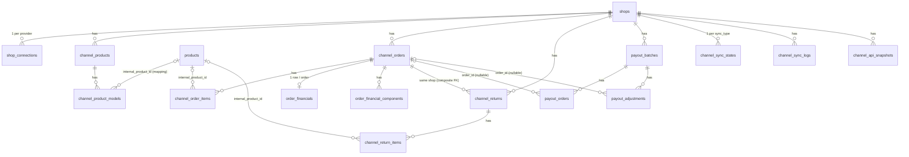

# Shopee Financial Core — Phase SHOPEE-0 (Foundation)

Phase SHOPEE-0 **chỉ** dựng nền: schema database, ràng buộc/index, RLS, domain
types, ranh giới module (mapper / financial engine / cost engine) và tài liệu
này. **Không** gọi Shopee API, không OAuth/token, không sync, không tính toán
tài chính, không cron, không UI.

| Thành phần | File |
|---|---|
| Migration | [`supabase/migrations/00038_shopee_financial_core.sql`](../supabase/migrations/00038_shopee_financial_core.sql) |
| Canonical types (channel-agnostic) | [`src/lib/channels/core/types.ts`](../src/lib/channels/core/types.ts), [`mapped.ts`](../src/lib/channels/core/mapped.ts), [`errors.ts`](../src/lib/channels/core/errors.ts) |
| Repository tối thiểu (server-only) | [`src/lib/channels/core/queries.ts`](../src/lib/channels/core/queries.ts) |
| Shopee (provider-specific) | [`src/lib/channels/shopee/types.ts`](../src/lib/channels/shopee/types.ts), [`mappers.ts`](../src/lib/channels/shopee/mappers.ts) |
| Financial Engine | [`src/lib/financial/types.ts`](../src/lib/financial/types.ts), [`engine.ts`](../src/lib/financial/engine.ts) |
| Internal Cost Engine | [`src/lib/inventory-cost/types.ts`](../src/lib/inventory-cost/types.ts) |
| Quyền | `channel:view` (mọi role), `channel:manage` (admin) trong [`src/lib/auth/permissions.ts`](../src/lib/auth/permissions.ts) |
| Test | [`src/lib/channels/schema.integration.test.ts`](../src/lib/channels/schema.integration.test.ts), [`src/lib/channels/core/types.test.ts`](../src/lib/channels/core/types.test.ts) |

---

## A. Architecture

```
Shopee Open Platform API
        │  (SHOPEE-1+: OAuth, API client, sync jobs — CHƯA có)
        ▼
channel_api_snapshots  ◄── raw JSON, lưu nguyên văn, append-only
        │
        ▼
src/lib/channels/shopee/mappers.ts   ◄── NƠI DUY NHẤT biết tên field Shopee
        │  MappedOrder / MappedOrderFinancials / MappedReturn / MappedPayout
        ▼
Canonical tables (channel_orders, channel_order_items, order_financials,
order_financial_components, channel_returns, payout_*)
        │
        ▼
src/lib/financial/engine.ts  ◄── calculateOrderFinancials(input canonical)
        ▲
src/lib/inventory-cost       ◄── COGS từ dữ liệu nhập hàng nội bộ
```

Nguyên tắc:

1. **Shopee chỉ là một sales channel.** Bảng dùng tên chung (`shops.channel`,
   `shop_connections.provider`, `channel_*`). Thêm Lazada/TikTok Shop sau này =
   mở rộng CHECK `channel IN (...)` + viết mapper mới; không đổi bảng core.
2. **Provider-specific** (tên field, endpoint, kiểu raw) nằm trong
   `src/lib/channels/shopee/` — module khác không được import từ đó.
3. **Canonical business logic** (financial engine, cost engine) chỉ nhận type
   canonical; signature không chứa tên field Shopee.
4. Pattern giống phần còn lại của app: đọc/ghi phía server bằng service-role
   client **sau khi** kiểm tra quyền qua `src/lib/auth/session.ts`.

## B. Entity relationships (ERD)



Dạng text:

```
shops ─┬─ shop_connections            (UNIQUE shop_id+provider)
       ├─ channel_products ── channel_product_models ──► products
       ├─ channel_orders ─┬─ channel_order_items ──► products
       │                  ├─ order_financials        (1:1)
       │                  ├─ order_financial_components
       │                  └─ channel_returns ── channel_return_items ──► products
       ├─ payout_batches ─┬─ payout_orders ──► channel_orders (nullable)
       │                  └─ payout_adjustments ──► channel_orders (nullable)
       ├─ channel_sync_states (UNIQUE shop_id+sync_type)
       ├─ channel_sync_logs
       └─ channel_api_snapshots
```

Hành vi khi xoá:

| Xoá | Kết quả |
|---|---|
| `shops` | CASCADE toàn bộ dữ liệu kênh của shop đó |
| `channel_orders` | CASCADE items, financials, components, returns; `payout_orders.order_id` / `payout_adjustments.order_id` → NULL (giữ lại `external_order_sn`) |
| `products` | `internal_product_id` → NULL ở models/order items/return items; model tự về `mapping_status = 'unmapped'` (trigger). **Không** xoá dữ liệu kênh, **không** chặn việc xoá product. |
| `profiles` | `channel_product_models.mapped_by` → NULL |

## C. Multi-shop model

- Hiện có 5 shop Shopee, phase đầu pilot 1 shop — schema phục vụ cả hai ngay
  từ đầu; **không** hardcode "shop 1" ở đâu cả.
- Mọi entity kênh gắn `shop_id` (trực tiếp hoặc qua cha: model → product → shop,
  item → order → shop).
- Khoá tự nhiên luôn **theo shop**, không bao giờ global:
  `UNIQUE(channel, external_shop_id)`, `UNIQUE(shop_id, external_order_sn)`,
  `UNIQUE(shop_id, external_item_id)`, `UNIQUE(shop_id, external_return_sn)`,
  `UNIQUE(shop_id, sync_type)`.
- `channel_returns` dùng composite FK `(order_id, shop_id) → channel_orders(id, shop_id)`
  nên return của shop B không thể trỏ vào order của shop A.
- Index phụ đều bắt đầu bằng `shop_id` (vd `(shop_id, created_at_channel)`) vì
  mọi truy vấn đều lọc theo shop. Index riêng `shop_id` không cần tạo: các
  UNIQUE `(shop_id, …)` đã phục vụ việc đó.
- External id lưu `text` (id Shopee có thể vượt 2^53, JS number sẽ mất chính xác).

## D. Product mapping strategy

- Map ở **model layer** (`channel_product_models.internal_product_id`), không
  ở item: một item có nhiều biến thể ứng với nhiều SKU nội bộ. Item không có
  biến thể sẽ được biểu diễn bằng 1 "model mặc định" khi sync (SHOPEE-1).
- Một SKU nội bộ có thể được bán ở nhiều shop/nhiều listing → nhiều model trỏ
  cùng một `products.id`.
- `model_sku` chỉ là gợi ý để **auto-match** lần đầu (`auto_mapped`).
  Sau khi map, `internal_product_id` là **source of truth**; người dùng có thể
  sửa tay (`manual_mapped`, ghi `mapped_by`/`mapped_at`). Trùng/mơ hồ →
  `mapping_conflict`.
- CHECK: `auto_mapped`/`manual_mapped` bắt buộc có `internal_product_id`.
- `channel_order_items.internal_product_id` là **snapshot** mapping tại thời
  điểm sync order — đổi mapping về sau không âm thầm làm đổi lịch sử order.

## E. Order lifecycle

`channel_orders.order_status` = trạng thái của **Shopee**, lưu `text`
(UNPAID, READY_TO_SHIP, PROCESSED, SHIPPED, TO_CONFIRM_RECEIVE, COMPLETED,
IN_CANCEL, CANCELLED, TO_RETURN, …). Không dùng DB enum/CHECK vì Shopee có thể
thêm trạng thái; validate ở application layer.

`channel_total_amount` = số tiền **người mua trả**. **Không phải** tiền seller
nhận được (settlement).

`channel_order_items`: **không** có UNIQUE `(order_id, external_order_item_id)`.
Theo tài liệu Shopee, `order_item_id` được **dùng chung** cho mọi item thuộc
cùng một bundle deal, nên nó không định danh được một dòng. Phase sync sẽ thay
thế toàn bộ item của một order theo từng lần sync (delete + insert trong một
transaction/RPC). Cần xác nhận lại bằng payload thật ở SHOPEE-1.

## F. Financial lifecycle

`channel_orders.financial_status` là lifecycle **riêng của mình**, độc lập
với `order_status` (CHECK):

```
pending ──► estimated ──► settlement_available ──► released
                 │                 │                   │
                 └────────► mismatch ◄─────────────────┘
                                   ▲
            return_adjusted ◄──────┘ (khi return/refund làm thay đổi số tiền)
```

| Trạng thái | Ý nghĩa |
|---|---|
| `pending` | Mới có order, chưa có số liệu tài chính |
| `estimated` | Đã tính ước tính từ dữ liệu order (phí ước tính) |
| `settlement_available` | Đã có escrow detail từ Shopee (số liệu thực tế) |
| `released` | Shopee đã giải ngân (có trong income/payout) |
| `mismatch` | Settlement tự tính lệch với Shopee vượt ngưỡng |
| `return_adjusted` | Có return/refund làm điều chỉnh số tiền |

## G. Estimated vs actual P&L

`order_financials` (1 dòng/order) chứa cả hai:

- **Estimated**: tính khi order mới có (giá bán, voucher, phí ước tính, COGS) →
  `estimated_profit`, `estimated_margin`.
- **Actual**: tính lại khi có escrow/income thật → `actual_profit`,
  `actual_margin`; `profit_variance = actual − estimated`.
- `calculation_version` + `calculated_at`: biết số liệu được tính bằng phiên
  bản công thức nào (đổi công thức → tính lại có kiểm soát).

**Quy ước dấu**: mọi cột thành phần lưu **độ lớn dương** của đúng thứ tên cột
nói (phí 5.000 lưu `5000`, không phải `-5000`). Chỉ `total_adjustment_amount`,
`*_variance` và các cột profit là có dấu. Riêng
`order_financial_components.amount` có dấu theo góc nhìn seller (+ tiền vào,
− tiền ra).

`order_financial_components`: dòng tiền mở rộng. Shopee thêm phí mới → lưu
được ngay với `component_type`/`provider_field` mới mà chưa cần thêm cột.
`category` (11 nhóm) và `funded_by` có CHECK vì engine tổng hợp theo đó;
`component_type`, `provider_field`, `source` là text mở.

## H. Return lifecycle

`channel_returns` (gắn order **cùng shop**) + `channel_return_items`.

- `status`, `reverse_logistics_status`, `seller_compensation_status` là text của
  provider.
- `channel_return_items.inventory_disposition` (CHECK): `pending` → `restock` /
  `damaged` / `lost` / `disposed`. Đây là quyết định **nội bộ** về hàng trả
  về. SHOPEE-0 **không** tạo inventory movement.
- Return làm thay đổi tiền → order chuyển `financial_status = return_adjusted`
  và được tính lại (phase sau).

## I. Payout reconciliation

```
payout_batches (1 lần Shopee chuyển tiền)
  ├─ payout_orders       (order nào nằm trong lần chuyển, escrow_amount)
  └─ payout_adjustments  (điều chỉnh: module/scenario/remark, có thể gắn order)
```

- `payout_orders.order_id` nullable: payout có thể nhắc tới order chưa sync;
  luôn giữ `external_order_sn` để link sau.
- Đối soát (phase sau):
  `calculated_settlement` (mình tự tính) so với `escrow_amount` (Shopee) →
  `settlement_variance`, `reconciliation_status` = `matched` / `warning` /
  `mismatch`; tổng `payout_orders.escrow_amount` + adjustments so với
  `payout_batches.payout_amount`.
- Shopee chưa rõ có payout id ổn định hay không → chưa có cột external id;
  thêm ở phase sync khi đã xem payload thật.

## J. Raw vs canonical data

| | Raw | Canonical |
|---|---|---|
| Bảng | `channel_api_snapshots` | `channel_orders`, `channel_order_items`, `order_financials`, `order_financial_components`, `channel_returns*`, `payout_*`, `channel_products*` |
| Nội dung | JSON nguyên văn của từng lần gọi API (`api_name`, `entity_type`, `entity_external_id`, `payload`) | Cột có kiểu, đã chuẩn hoá, dùng cho query/UI/engine |
| Ai đọc | Chỉ server (debug, re-map khi sửa mapper) | UI, báo cáo, engine |

Quy tắc:

- **UI không bao giờ đọc raw JSON.**
- Không nhồi mọi field provider vào bảng canonical. Field chưa có chỗ → nằm
  trong snapshot, hoặc (nếu là tiền) thành một `order_financial_components`.
- Snapshot là append-only (nhiều bản theo thời gian, không UNIQUE). **Tăng
  trưởng dung lượng**: 1 bản/lần fetch/entity → cần retention policy ở phase
  sync (vd giữ bản mới nhất + bản đầu tiên của mỗi entity, xoá bản trung gian
  sau N ngày, hoặc chỉ ghi khi payload đổi — so hash).

## K. COGS source

- COGS = giá vốn **nội bộ**, tính từ dữ liệu nhập hàng (receipts/invoices) bởi
  Internal Cost Engine (`src/lib/inventory-cost`, interface `CostResolver`).
- **Không** dùng giá bán Shopee làm COGS.
- **Không** dùng `products.current_price` làm COGS lịch sử (đó là giá hiện
  tại, đổi theo thời gian).
- Khi tính, giá vốn được **đóng băng** vào
  `channel_order_items.cost_per_unit_snapshot` / `total_cogs` cùng
  `cost_method` (`moving_average` / `fifo` / `manual` / `unknown`) và
  `cogs_calculated_at`; tổng vào `order_financials.internal_cogs`.

## L. Future modules

Theo thứ tự dự kiến: SHOPEE-1 OAuth + token + API client → sync products/models
+ auto-mapping → sync orders → escrow/income → Financial Engine + COGS →
returns → payouts + reconciliation → inventory movement → ads, traffic,
product analytics, voucher/marketing, dashboard.

## M. Security

Cùng mô hình với migration 00036 (xem `docs/authentication-authorization.md`):

- App đọc/ghi phía server bằng **service-role** sau khi kiểm tra quyền
  (`channel:view`, `channel:manage`). Sync job (SHOPEE-1+) cũng chạy bằng
  service-role phía server.
- `anon`: không có quyền gì trên các bảng mới.
- `authenticated` (truy cập trực tiếp bằng JWT qua PostgREST): **chỉ SELECT**,
  lọc bởi RLS; **không ai** (kể cả admin) ghi trực tiếp được.

| Bảng | admin | staff | viewer |
|---|---|---|---|
| shops, channel_products/models, channel_orders/items, order_financials/components, channel_returns/items, payout_* | đọc | đọc | đọc |
| shop_connections (trừ cột token) | đọc | — | — |
| `access_token_encrypted`, `refresh_token_encrypted` | — | — | — |
| channel_sync_states, channel_sync_logs | đọc | — | — |
| channel_api_snapshots (có thể chứa PII người mua) | — | — | — |
| Ghi bất kỳ bảng nào | qua server action có `channel:manage` | — | — |

Cột token: chỉ GRANT SELECT theo **cột** cho các cột không bí mật, nên
`select=*` hay `select=access_token_encrypted` từ client đều bị từ chối,
bất kể role. Token phải được mã hoá ở app layer trước khi lưu (SHOPEE-1, giống
`src/lib/zalo/crypto.ts`). SHOPEE-0 không lưu token thật nào.

`src/lib/channels/core/queries.ts` liệt kê cột tường minh và không bao giờ
select cột token.

## Money rules

- DB: `NUMERIC(18,2)` cho tiền, `NUMERIC(18,4)` cho số lượng/tồn/kích thước,
  `NUMERIC(9,4)` cho margin, `NUMERIC(18,8)` cho tỷ giá. Không có `float`.
- TypeScript: giá trị NUMERIC được biểu diễn bằng `Decimal = string`
  (vd `"125000.00"`), đọc bằng cast `col::text` để nhận đúng giá trị đã lưu.
  **Không** tính tiền bằng JS `number` (0.1 + 0.2 ≠ 0.3).
- Phase tính toán sẽ chọn một trong hai: thư viện decimal (vd `decimal.js`)
  hoặc chiến lược integer minor-unit (VND không có xu → BigInt đồng). SHOPEE-0
  chưa thêm package nào.

## Shopee API roles

| Nhóm | API | Vai trò |
|---|---|---|
| Order | `v2.order.get_order_list` | Liệt kê order_sn theo cửa sổ thời gian (sync tăng dần) |
| | `v2.order.get_order_detail` | Trạng thái, item_list, giá, phí ship ước tính → `channel_orders`, `channel_order_items` |
| Product | `v2.product.get_item_list` | Liệt kê item_id |
| | `v2.product.get_item_base_info` | Tên, SKU, category, has_model, giá, tồn → `channel_products` |
| | `v2.product.get_model_list` | Biến thể: model_id, model_sku, giá, tồn → `channel_product_models` |
| Payment | `v2.payment.get_escrow_detail` | Breakdown tài chính của 1 order → `order_financials`, `order_financial_components` |
| | `v2.payment.get_income_detail` | Thu nhập theo kỳ (đã/đang release) → `released_amount`, `financial_status` |
| | `v2.payment.get_income_overview` | Tổng quan thu nhập để đối soát |
| | `v2.payment.get_payout_detail` | Payout + order/adjustment → `payout_*` |
| Returns | `v2.returns.get_return_list` | Liệt kê return_sn |
| | `v2.returns.get_return_detail` | Lý do, tiền hoàn, item, vận chuyển ngược → `channel_returns*` |

(Danh sách này cũng có trong code: `SHOPEE_APIS` ở `src/lib/channels/shopee/types.ts`.)

## N. Phase boundaries

**SHOPEE-0 (đã làm):** migration 00038 (16 bảng, CHECK, index, trigger,
RLS/grant), domain types, mapper skeleton, engine/cost interface, quyền
`channel:*`, repository đọc tối thiểu, test, tài liệu này.

**Không làm trong SHOPEE-0:** Shopee OAuth, token refresh, API client, sync
products/orders/payments/returns/payouts, tính tài chính, tính COGS, inventory
movement, ads, traffic, voucher, marketing, dashboard, UI Shopee, cron,
background job. Không seed shop/token/dữ liệu tài chính nào.

Các hàm skeleton (`calculateOrderFinancials`, `mapShopee*`) ném
`NotImplementedError` nếu bị gọi.

## Shopee Connection / Auth (SHOPEE-1)

Runbook vận hành từng bước: [`docs/shopee-auth-runbook.md`](shopee-auth-runbook.md).

### Module

| File | Vai trò |
|---|---|
| `src/lib/channels/shopee/config.ts` | Đọc + validate env (báo tên biến thiếu, không bao giờ in giá trị) |
| `src/lib/channels/shopee/signing.ts` | **Nơi duy nhất** tạo chữ ký |
| `src/lib/channels/shopee/client.ts` | `ShopeeClient.request()` — timeout, retry, giới hạn đồng thời, chuẩn hoá lỗi, log an toàn |
| `src/lib/channels/shopee/errors.ts` | `ShopeeApiError` (apiPath, errorCode, message, requestId, httpStatus, category, retryable) |
| `src/lib/channels/shopee/auth.ts` | URL ủy quyền, đổi code → token, refresh token |
| `src/lib/channels/shopee/token.ts` | `ShopeeConnectionService`: lưu token mã hoá, `getValidAccessToken`, trạng thái, `testConnection`; `getShopeeConnectionHealth` |
| `src/lib/channels/shopee/state.ts` | State chống CSRF cho vòng ủy quyền |
| `src/lib/channels/shopee/server.ts` | Wiring server-only (env + service-role + fetch thật) — entry point duy nhất cho route/page |
| `src/lib/security/secrets.ts` | `encryptSecret` / `decryptSecret` (AES-256-GCM, dùng chung) |
| `src/app/api/shopee/auth/start`, `…/auth/callback`, `…/test-connection` | Route (admin-only) |
| `src/app/(authenticated)/settings/shopee` | Trang quản trị |

### Biến môi trường (server-only, không bao giờ `NEXT_PUBLIC_*`)

| Biến | Bắt buộc | Ghi chú |
|---|---|---|
| `SHOPEE_PARTNER_ID` | ✔ | Số nguyên, lấy từ Shopee Open Platform console |
| `SHOPEE_PARTNER_KEY` | ✔ | Bí mật. Live và test (sandbox) có key KHÁC nhau |
| `SHOPEE_API_BASE_URL` | – | Mặc định `https://partner.shopeemobile.com`; sandbox `https://partner.test-stable.shopeemobile.com` |
| `SHOPEE_REDIRECT_URL` | – | Mặc định `${APP_URL}/api/shopee/auth/callback`; domain phải khớp redirect domain đăng ký với Shopee |
| `APP_ENCRYPTION_KEY` | ✔ | 32 byte ngẫu nhiên base64 (`openssl rand -base64 32`). Đổi key = mọi shop phải kết nối lại |
| `APP_URL` | (✔ nếu không đặt `SHOPEE_REDIRECT_URL`) | Đã có từ Zalo |

### Ký request (Shopee v2)

`sign = hex(HMAC-SHA256(partner_key, partner_id + api_path + timestamp [+ access_token + shop_id]))`

- Public (auth_partner, auth/token/get, auth/access_token/get): `partner_id + api_path + timestamp`.
- Shop-level: thêm `access_token + shop_id`.
- `timestamp` = Unix **giây**, phải trùng với giá trị gửi trên query; Shopee từ chối
  timestamp cũ (~5 phút) → ký lại cho **mỗi lần thử**, không tái dùng chữ ký.
- Nguồn: tài liệu bên thứ ba (open.shopee.com không truy cập được khi build) —
  unit test đối chiếu với vector HMAC tính độc lập bằng `openssl`. Cần xác nhận
  bằng lần gọi thật đầu tiên (xem "Real payload validation").

### Luồng ủy quyền

```
Admin bấm "Kết nối shop Shopee"
  → GET /api/shopee/auth/start           (channel:manage; tạo state, cookie httpOnly 10 phút)
  → 307 {base}/api/v2/shop/auth_partner?partner_id&timestamp&sign&redirect=<callback?state=…>
  → Seller đăng nhập Shopee, chọn shop, đồng ý
  → GET /api/shopee/auth/callback?state=…&code=…&shop_id=…
       1. phiên admin (channel:manage)
       2. state query == cookie (so sánh constant-time) — thiếu/sai → state_mismatch
       3. shop_id là số hợp lệ; main_account_id (tài khoản chính) → chưa hỗ trợ
       4. POST /api/v2/auth/token/get {code, shop_id, partner_id}  (không retry)
       5. GET get_shop_info (best-effort, lấy tên/khu vực)
       6. upsert shops (channel, external_shop_id) + shop_connections (connected)
  → 307 /settings/shopee?shopee=connected|reconnected|error&reason=…
```

- `external_shop_id` **chỉ** đến từ Shopee (query callback, được chứng minh bởi
  việc đổi code thành công) — không có ô nhập tay.
- Đổi code thất bại: nếu shop đã tồn tại → `connection_status = error` + lỗi an
  toàn; nếu chưa → không tạo shop nào.
- State nằm trong `redirect` URL của mình vì auth_partner không có tham số
  `state` riêng. **Cần xác nhận** Shopee giữ nguyên query của redirect URL; nếu
  không, callback sẽ từ chối (fail closed) và phải đổi cơ chế.

### Lưu token + mã hoá

- `access_token_encrypted` / `refresh_token_encrypted` = `v1.<iv>.<tag>.<ciphertext>`
  (base64url), AES-256-GCM, IV ngẫu nhiên 96-bit, key `APP_ENCRYPTION_KEY`.
- AAD = `shop_connections:<shops.id>:<cột>` → ciphertext chép sang shop khác
  hoặc tráo cột access/refresh sẽ không giải mã được.
- Token rõ chỉ tồn tại trong bộ nhớ server; không có trong DB, log, response.
- Đổi key: hiện chưa hỗ trợ giải mã bằng key cũ — đổi key = kết nối lại từng
  shop. (Có thể thêm `v2`/key id khi cần xoay key có kế hoạch.)

### Refresh + chống refresh đồng thời

`getValidAccessToken(shopId)`:

1. Token còn hạn > `TOKEN_REFRESH_BUFFER_SECONDS` (10 phút) → trả về luôn.
2. Ngược lại refresh, với 3 lớp bảo vệ (Shopee **xoay** refresh token mỗi lần):
   - trong 1 instance: các lời gọi đồng thời dùng chung 1 promise;
   - giữa các instance: lease trên dòng `shop_connections` qua RPC
     `claim_shop_token_refresh` (migration 00039, dùng **đồng hồ DB**, lease 60s).
     Instance không giành được lease chờ (poll 300ms, tối đa 15s) rồi đọc lại
     token mới — không tự refresh;
   - refresh thất bại → đọc lại dòng: nếu refresh token đã đổi (instance khác vừa
     xoay) thì dùng token mới, **không** đánh dấu revoked.
3. Refresh là POST và **không bao giờ retry** (retry có thể dùng lại refresh
   token đã bị xoay).
4. Thành công: lưu cả access + refresh token mới, `access_token_expires_at`,
   `last_token_refresh_at`, `connection_status = connected`, xoá lỗi.

Hằng số ở `src/lib/channels/shopee/constants.ts` (không rải magic number).

### Trạng thái kết nối

| Trạng thái | Khi nào | Tự refresh? |
|---|---|---|
| `connected` | Ủy quyền / refresh thành công | ✔ |
| `error` | Đổi code thất bại, lỗi chữ ký/cấu hình, giải mã thất bại, API trả lỗi auth (token bị buộc refresh ở lần sau) | ✔ |
| `expired` | Refresh bị từ chối (lỗi auth, không phải thu hồi) | ✘ — admin kết nối lại |
| `revoked` | Refresh bị từ chối với nội dung "revoke/deauthorize/…" | ✘ — admin kết nối lại |
| `disconnected` | Chưa từng kết nối | ✘ |

- Lỗi tạm thời (mạng, timeout, 5xx, rate limit) **không bao giờ** đổi trạng thái —
  chỉ ghi `last_error_*`.
- Gọi API thành công → `last_successful_api_call_at`.
- `last_error_message` kèm `request_id` của Shopee (để gửi Shopee support).
- Phân loại mã lỗi Shopee là **best-effort** (theo pattern `auth/token/permission`,
  `error_sign`, HTTP status) — mã lạ được coi là `unknown`, không bao giờ là revoked.

### Retry / rate limit

- Chỉ retry lời gọi idempotent (GET) với lỗi `transient` (timeout, mạng, 5xx,
  `error_server`/`system_busy`…) hoặc `rate_limit` (HTTP 429, `…too_many…`).
- Tối đa `MAX_READ_RETRIES = 2`, backoff mũ 500ms × 2ⁿ + jitter, tôn trọng
  `Retry-After` (tối đa 10s). Không retry: chữ ký, auth, validation, POST.
- Mỗi client giới hạn `MAX_CONCURRENT_REQUESTS = 4` request đồng thời (semaphore)
  — sync phase sau dùng chung, không fan-out vô hạn. Chưa có hàng đợi phân tán
  (giới hạn theo instance). Ngưỡng rate limit thật của Shopee: chưa xác minh.

### Test connection + health

- `testConnection(shopId)` → `GET /api/v2/shop/get_shop_info` (chỉ đọc). Trả
  `{ ok, shopId, requestId, latencyMs, shopName, error? }`. **Không** lưu raw
  payload (snapshot chỉ bắt đầu từ các phase sync).
- `getShopeeConnectionHealth(db, shopId)` → `{ connectionStatus, tokenStatus
  (valid | expiring_soon | expired | missing), expiresAt, lastRefreshAt,
  lastSuccessfulApiCallAt, lastError }` — không bao giờ có token.

### Log / sự kiện

Log JSON một dòng, `source: "shopee"`: `shopee_api_call` (apiPath, method, shopId,
externalShopId, httpStatus, requestId, errorCode, category, latencyMs, attempt),
và các sự kiện `SHOPEE_CONNECTED`, `SHOPEE_RECONNECTED`, `SHOPEE_TOKEN_REFRESHED`,
`SHOPEE_CONNECTION_ERROR`, `SHOPEE_REVOKED`. **Không bao giờ** log: partner key,
chữ ký, base string, access/refresh token, query string, body, code ủy quyền.
Project chưa có framework audit log trong DB → chỉ dùng log ứng dụng (Vercel
logs), không dựng framework mới.

### Bảo mật

- Route `start`/`callback`/`test-connection` và trang `/settings/shopee` đều kiểm
  tra `channel:manage` (admin) ở server; staff/viewer nhận 403 / trang forbidden.
- `shopId` của test-connection được validate (UUID) và chỉ dẫn tới dữ liệu của
  chính shop đó; token không bao giờ rời server nên không thể lấy token qua URL.
- Partner key chỉ dùng phía server; URL ủy quyền chỉ chứa `partner_id`,
  `timestamp`, `sign`.
- Component client (`test-connection-button.tsx`) chỉ gọi route, không import
  module Shopee.
- Response lỗi chỉ chứa mã lỗi + message của Shopee (đã redact mọi bí mật mình
  gửi đi nếu provider echo lại).

## Product Sync Architecture (SHOPEE-2)

> **Trạng thái: FIXTURE-FIRST.** Toàn bộ pipeline chạy và được test bằng fixture
> dựng từ *response example trong tài liệu*. Chưa từng chạy với API Shopee thật —
> xem "Product real-payload validation" bên dưới.

### Thành phần

```
ShopeeProductProvider (port)            src/lib/channels/shopee/product-provider.ts
 ├─ RealShopeeProductProvider   → ShopeeClient + token service (SHOPEE-1), HTTP
 └─ FixtureShopeeProductProvider → tests/fixtures/shopee/product/*.json
        │ raw JSON + request_id
        ▼
product-adapter.ts + dto/product.ts      ← NƠI DUY NHẤT biết field Shopee (zod, khoan dung)
        │ MappedChannelProduct / MappedChannelModel (canonical)
        ▼
ShopeeProductSyncService (product-sync.ts) — 1 implementation cho cả live và fixture
        │
        ├─ core/product-catalog.ts   upsert channel_products / channel_product_models
        ├─ core/snapshots.ts         saveLatestChannelSnapshot (catalog only)
        ├─ core/sku-mapping.ts       auto-map / manual map / unmap / review flag
        └─ core/sync-log.ts          channel_sync_states + channel_sync_logs
```

Payload thật khác tài liệu → chỉ sửa `dto/product.ts` + `product-adapter.ts`.

### Provider mode

| `SHOPEE_PROVIDER_MODE` | Mặc định | Ghi chú |
|---|---|---|
| `fixture` | ngoài production | Chỉ đồng bộ **shop fixture** (`shops.data_source = 'fixture'`) |
| `live` | production | Cần cấu hình SHOPEE-1 đầy đủ; thiếu → UI báo "Chưa kết nối API Shopee" |

- Fixture trên production bị chặn trừ khi `ENABLE_SHOPEE_FIXTURE_MODE=true`.
- **Không có fallback live → fixture.** Sync từ chối khi `data_source` của shop khác
  mode của provider (`source_mismatch`) → dữ liệu fixture không thể vào shop thật.
- Shop fixture: tạo bằng nút "Tạo shop fixture (dev)" (chỉ hiện khi fixture được
  phép) → `external_shop_id = FIXTURE_SHOP_001`, tên `[FIXTURE] …`, badge FIXTURE
  ở mọi nơi. Không có trong migration.
- Snapshot ghi `source_mode = fixture|live`.

### Luồng đồng bộ (`syncShopeeProducts` = `ShopeeProductSyncService.sync`)

1. Kiểm tra shop (tồn tại, kênh shopee, data_source khớp mode), không có lượt
   sync product khác đang chạy (< 30 phút).
2. **Discovery** `v2.product.get_item_list`: `page_size = 100`, đủ 6 trạng thái
   (`NORMAL, UNLIST, REVIEWING, BANNED, SELLER_DELETE, SHOPEE_DELETE`) để item bị
   ẩn/xoá cũng cập nhật trạng thái local. Phân trang `offset → next_offset` tới khi
   `has_next_page = false`; `next_offset` không tăng → dừng với lỗi (chống lặp vô hạn).
3. **Chi tiết** `get_item_base_info` theo lô 50 id → `channel_products`.
4. **Biến thể**: `has_model = true` → `get_model_list` → `channel_product_models`;
   `has_model = false` → 1 đơn vị **synthetic** (xem bên dưới).
5. Snapshot raw (chỉ giữ bản mới nhất), 6. auto-map + cờ review, 7. state + log.

**Incremental**: `mode = incremental` dùng `update_time_from = last_success_at − 5 phút`
(overlap chống sót biên), `update_time_to = thời điểm bắt đầu`. Chưa có lần thành
công → chạy full. Chưa lên lịch cron.

### Upsert

- `channel_products` theo `UNIQUE(shop_id, external_item_id)`; `channel_product_models`
  theo `UNIQUE(channel_product_id, external_model_id)` → chạy lại không tạo trùng.
- Sync **chỉ ghi cột của provider** — không bao giờ ghi `internal_product_id`,
  `mapping_status`, `mapped_*` → không thể ghi đè mapping.
- Model không còn trong `get_model_list` (hoặc item đổi có/không biến thể) →
  `removed_at` được đặt, **giữ nguyên dòng + mapping** (lịch sử); xuất hiện lại →
  `removed_at = NULL`. Chỉ đánh dấu khi danh sách model parse sạch hoàn toàn.
- Item không còn được discovery trả về: không tự xoá/ẩn (có thể do bộ lọc); trạng
  thái cập nhật qua `item_status` (UNLIST/…_DELETE).

### Sản phẩm không có biến thể — synthetic model

Item `has_model = false` vẫn cần một "đơn vị bán được" để ghép SKU, nên mọi thứ đi
qua một abstraction duy nhất **channel sellable unit (channel_product_models) →
products**:

- `external_model_id = 'NO_MODEL'`, `is_synthetic = true` (CHECK: hai điều này luôn
  đi cùng nhau), `model_sku = item_sku`, `model_name = NULL`, giá/tồn/kích thước của item.
- `NO_MODEL` là id **nội bộ**, không phải id Shopee trả về.
- SHOPEE-3 sẽ khớp dòng order có `model_id` rỗng/0 vào đơn vị `NO_MODEL` của item đó
  (cần xác nhận Shopee trả gì cho item không biến thể).

### Ghép SKU

- **Danh tính** của đơn vị bán = `shop_id + external_item_id + external_model_id`.
  SKU chỉ là **công cụ hỗ trợ ghép**, không phải danh tính. Order (SHOPEE-3) khớp
  theo danh tính, **không** theo chuỗi SKU.
- **Auto-map** (`autoMapChannelModels`, nút "Tự động ghép SKU", cũng chạy cuối mỗi
  lượt sync): chuẩn hoá = trim + chữ thường (SKU nội bộ dạng snake_case chữ
  thường). Không bỏ ký tự, không fuzzy, không theo tên. So với sản phẩm nội bộ
  **đang hoạt động**. 1 kết quả → `auto_mapped`; 0 → `unmapped`; ≥ 2 (vd `ABC` và
  `abc` cùng tồn tại) → `mapping_conflict` (không chọn bừa). Chỉ chạm dòng
  `unmapped`/`mapping_conflict`, mỗi lệnh ghi có điều kiện trạng thái → ghép tay
  đồng thời luôn thắng.
- **Ổn định**: SKU Shopee của dòng `auto_mapped` đổi và không còn khớp SKU nội bộ →
  **giữ mapping**, bật `mapping_review_required` (badge "Cần kiểm tra lại").
  Khớp lại → tự tắt. Ghép tay không bao giờ bị gắn cờ.
- **Ghép tay** (`mapChannelModelToProduct`, quyền `channel:map` = admin + staff):
  server kiểm tra model + product tồn tại, chỉ nhận 2 id từ trình duyệt; ghi
  `manual_mapped`, `mapped_at`, `mapped_by`. Có thể ghép với sản phẩm ngừng hoạt động
  (hiện badge cảnh báo).
- **Bỏ ghép** (`unmapChannelModel`): về `unmapped`, xoá `mapped_*`. ⚠️ **Phải siết lại
  ở SHOPEE-3**: khi đã có order dùng mapping này, không cho bỏ ghép/đổi ghép âm thầm.

### Màn hình `/shopee/products`

Quyền: `channel:view` (mọi role) xem; `channel:map` (admin, staff) ghép/bỏ ghép;
`channel:manage` (admin) đồng bộ, tự ghép, tạo shop fixture. Gồm: banner fixture mode
(chỉ khi thật sự ở fixture mode) hoặc "Chưa kết nối API Shopee"; khối Shop & đồng bộ
(lần sync gần nhất + nút); 6 thẻ tổng hợp (đang bán / đã ghép / chưa ghép / xung đột /
cần kiểm tra / ngừng bán-đã xoá — từ RPC `get_channel_mapping_summary`); bảng có lọc
shop, trạng thái ghép, trạng thái Shopee, tên, SKU Shopee, SKU nội bộ; dialog chi tiết
(không hiện raw JSON). Dữ liệu đọc từ view `v_channel_model_listing` (không N+1).

> **Quy tắc trước SHOPEE-3:** không xử lý order thật cho tới khi các biến thể đang
> bán chủ chốt đã được ghép (thẻ "Chưa ghép" và "Xung đột" ≈ 0).

### Giá / tồn kho Shopee ≠ nội bộ

- `channel_*_price` là **giá bán**. Không bao giờ ghi vào `products.current_price`,
  không bao giờ dùng làm COGS.
- `available_stock` / `reserved_stock` là **tồn trên Shopee**. Không đối chiếu/ghi
  vào tồn kho nội bộ, không đẩy tồn về Shopee. (Test xác nhận bảng `products`,
  receipts/invoices/payments không đổi sau sync.)

### Số (NUMERIC)

Giá/tồn đi qua `toDecimalString` (`core/decimal.ts`): số JSON của provider → chuỗi
thập phân đúng như literal (≤ 15 chữ số có nghĩa, không exponent), ghi vào NUMERIC
dưới dạng chuỗi; view trả NUMERIC dạng text; UI định dạng chuỗi, không đổi sang float.
Id > 2^53 bị từ chối (parse error), không lưu sai.

### Snapshot sản phẩm

`saveLatestChannelSnapshot`: đúng **1 bản mới nhất** cho mỗi
`(shop, entity_type, entity_external_id, api_name)` với `entity_type ∈ {product, model}`.
Payload giống hệt (sha-256 trên JSON sắp xếp key) → chỉ cập nhật `synced_at`; khác →
thay bản cũ. Hàm từ chối entity type khác: **không** áp dụng cho escrow/income/
payout/return (giữ lịch sử lâu dài).

### Sync state / log / lỗi từng phần

- `channel_sync_states(sync_type = 'product')`: `last_offset`, `last_window_from/to`,
  `last_success_at`, `last_failure_at`, `last_error_*` (cursor = NULL vì phân trang offset).
- `channel_sync_logs`: `running → success | partial | failed`, `records_fetched`
  (item discovered), `records_created/updated` (item + model), `records_failed`;
  metadata: `pagesFetched, itemsDiscovered, modelsFetched, autoMapped, unmapped,
  conflicts, sourceMode, syncMode, window, failures[≤50]` (id + lý do, không bí mật).
- **Lỗi từng phần**: lô/item lỗi được ghi lại, phần còn lại vẫn chạy → `partial`.
  Chỉ lượt `success` mới tiến `last_success_at` (checkpoint incremental) → lượt
  incremental kế tiếp sẽ quét lại phần bị lỗi. Discovery lỗi → `failed`, không tiến gì.
- Payload hỏng: entry không có id hợp lệ / sai kiểu → ghi vào failures, **không insert**.

### Product real-payload validation (CHƯA kiểm chứng — làm sau Go-Live)

- [ ] Kiểu `item_id` (number? string? vượt 2^53?)
- [ ] Kiểu `model_id`; item không biến thể trả `model_id` gì trong order (0?)
- [ ] `item_sku` trống: `""` hay thiếu field?
- [ ] `model_sku` trống: `""` hay thiếu field?
- [ ] Item không biến thể: có `price_info`/`stock_info_v2` ở item không
- [ ] Item kit/bundle: `tag.kit` và cấu trúc thành phần
- [ ] Nhiều kho (`seller_stock`/`shopee_stock` nhiều location) — `summary_info` có đúng tổng?
- [ ] `price_info` có > 1 phần tử không
- [ ] Độ chính xác giá VND (số nguyên? có `.0`?)
- [ ] Item UNLIST / SELLER_DELETE / SHOPEE_DELETE còn trả `get_item_base_info`/`get_model_list` không
- [ ] `update_time` thay đổi khi nào; giới hạn độ dài cửa sổ `update_time_from/to`
- [ ] Phân trang: `next_offset`, `total_count`, giới hạn offset tối đa
- [ ] Cách truyền `item_status` (lặp key?) và `item_id_list` (dấu phẩy?) trên query
- [ ] Rate limit thực tế của các API product

## Snapshot retention (thiết kế — chưa triển khai)

Áp dụng **trước khi** bật sync định kỳ trên production (carry-forward #6). Chưa
có cron dọn dẹp ở SHOPEE-1.

| Loại (`entity_type` / `api_name`) | Giữ | Lý do |
|---|---|---|
| A. Product / model | Bản mới nhất mỗi (entity, api) + lịch sử ngắn 7–14 ngày | Chỉ để debug mapping; dữ liệu đổi liên tục |
| B. Order detail | Bản mới nhất + các bản tại **thời điểm đổi trạng thái** (`order_status` khác bản trước) | Tránh lưu mỗi lần polling |
| C. Escrow / income | Lâu dài | Kiểm toán tài chính, tính lại P&L |
| D. Return | Lâu dài (ít nhất bằng thời hạn lưu chứng từ kế toán) | Tranh chấp, đối soát hoàn tiền |
| E. Payout | Lâu dài | Đối soát tiền về tài khoản |

Chiến lược helper dự kiến (phase sync):

1. **Ghi có điều kiện**: tính hash (SHA-256) của payload đã chuẩn hoá; chỉ insert
   snapshot khi hash khác bản mới nhất của cùng (shop, entity_type,
   entity_external_id, api_name) — cần thêm cột `payload_hash` + index bằng
   migration mới.
2. **Đánh dấu bản cần giữ**: cột `retention_class` (`ephemeral` | `transition` |
   `financial`) gán lúc ghi theo bảng trên.
3. **Dọn dẹp** (job sau này, chạy theo lô): xoá `ephemeral` cũ hơn N ngày trừ bản
   mới nhất mỗi entity; không bao giờ xoá `financial`.
4. Theo dõi dung lượng bảng trước/sau khi bật sync cho shop thí điểm.

## Real payload validation (cần làm khi có shop thật)

Chỉ ghi lại **metadata an toàn** (không token, không payload đầy đủ), báo cáo trước
SHOPEE-2:

- [ ] `shop_id` trên callback: kiểu/độ dài thật; Shopee có giữ `?state=` trong redirect URL không
- [ ] Callback có trả `main_account_id` không (tài khoản của mình là shop hay main account)
- [ ] Response `token/get`: các field thật, `expire_in` thật (≈14400?), có `shop_id_list` không
- [ ] Response `access_token/get`: refresh token có đổi mỗi lần không; token cũ còn dùng được bao lâu
- [ ] `get_shop_info`: field thật (`shop_name`, `region`, `status`, `expire_time`…)
- [ ] `request_id` có trên mọi response (thành công + lỗi)
- [ ] Shape lỗi thật: chữ ký sai, token hết hạn, refresh token sai — đúng mã `error` để chỉnh `classifyShopeeError`
- [ ] Hành vi rate limit: HTTP status, mã lỗi, có `Retry-After` không

## Carry-forward constraints (bắt buộc cho SHOPEE-1+)

1. **Chưa chốt định danh unique của `channel_order_items`** cho tới khi đã xem
   payload Shopee thật. Kiểm chứng hành vi `order_item_id` bằng order thật có:
   nhiều item, nhiều model, add-on deal, bundle/kit, return một phần.
2. **Không tự bịa payout external ID.** Xem payload thật của
   `get_payout_detail` trước. Nếu Shopee không có định danh payout ổn định →
   thiết kế idempotency tất định một cách tường minh.
3. **Mapping escrow → canonical phải được kiểm chứng bằng payload VN thật.**
   Không đếm trùng các cặp gross/net tương đương hay các field rebate/offset.
4. **`channel_returns.order_id` vẫn NOT NULL.** Sync return phải đảm bảo order
   được tham chiếu đã được sync trước.
5. **NUMERIC dùng cho logic tài chính phải được select/cast `::text` tại ranh
   giới dữ liệu** khi cần. Không dựa vào JS floating-point cho phép tính tiền
   có tính quyết định.
6. **Phải có retention policy cho `channel_api_snapshots` trước khi bật sync
   định kỳ trên production.** Không giữ mọi snapshot polling mãi mãi.
7. **Raw snapshot chỉ để audit/debug/tính lại.** Bảng canonical là nguồn vận
   hành cho UI và truy vấn nghiệp vụ.

## Chạy test

```bash
npx supabase start          # Docker Desktop phải đang chạy
npx supabase migration up   # áp 00038 vào DB local
npm test                    # gồm schema.integration.test.ts (chạy vào DB trong .env.local)
```
